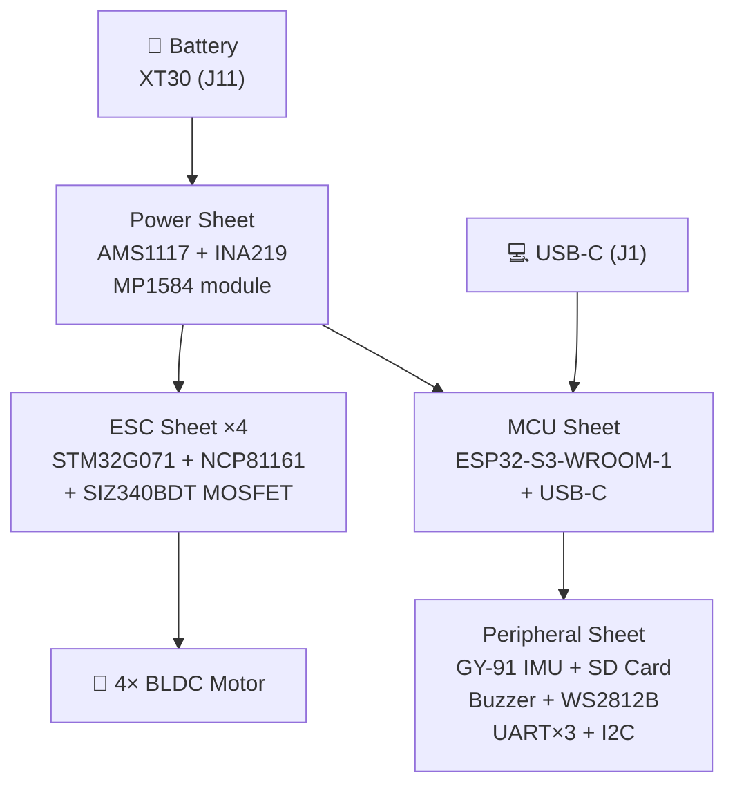

# 📋 BOM – Drone ver2 (đọc từ file .kicad_sch)

> [!NOTE]
> Dữ liệu được đọc trực tiếp từ các file KiCad schematic (S-expression format).
> Cấu trúc: `Drone ver2.kicad_sch` (top-level) → 4 sub-sheet bên dưới.
>
> | Sub-sheet | File | Số linh kiện |
> |---|---|---|
> | ESC (4-in-1) | [`ESC.kicad_sch`](file:///D:/TheProject/Drone/Drone%20ver2/Drone%20ver2/ESC.kicad_sch) | 194 |
> | MCU | [`MCU.kicad_sch`](file:///D:/TheProject/Drone/Drone%20ver2/Drone%20ver2/MCU.kicad_sch) | 13 |
> | Peripheral | [`Peripheral.kicad_sch`](file:///D:/TheProject/Drone/Drone%20ver2/Drone%20ver2/Peripheral.kicad_sch) | 37 |
> | Power | [`Open-ESPilot-Power.kicad_sch`](file:///D:/TheProject/Drone/Drone%20ver2/Drone%20ver2/Open-ESPilot-Power.kicad_sch) | 25 |
> | **Tổng** | | **269** |

---

## 🔵 IC / Active Components

| Ref | Linh kiện | Package | LCSC | Sheet |
|---|---|---|---|---|
| U1 | **TPS72733DSE** – LDO 3.3V | WSON-6 1.5×1.5mm | — | ESC |
| U2, U3, U16, U17 | **STM32G071GBU6** – MCU ARM Cortex-M0+ | UFQFPN-28 | — | ESC |
| U4–U9, U18–U23 | **NCP81161MNTBG** – Half-Bridge Gate Driver | DFN-8 2×2mm | — | ESC |
| U34–U45 | **SIZ340BDT-T1-GE3** – Power MOSFET (PowerPAIR) | MOSFET_DT-T1-GE3 | — | ESC |
| U30 | **ESP32-S3-WROOM-1-N16R8** – WiFi/BT MCU chính | ESP32-S3-WROOM-1 | [C2913198](https://www.lcsc.com/product-detail/C2913198.html) | MCU |
| U31 | **Micro_SD_Card** – Thẻ nhớ microSD | Hirose DM3AT | [C114218](https://www.lcsc.com/product-detail/C114218.html) | Peripheral |
| U32 | **AMS1117-3.3** – LDO 3.3V (module phụ) | SOT-89-3 | [C880752](https://www.lcsc.com/product-detail/C880752.html) | Power |
| U33 | **INA219AxD** – Current/Power Monitor I2C | SOIC-8 | [C1574856](https://www.lcsc.com/product-detail/C1574856.html) | Power |

> [!IMPORTANT]
> Schematic dùng **SIZ340BDT** (không phải SIZ200DT như trong file .csv). File `.kicad_sch` là nguồn thiết kế gốc chính xác hơn.

---

## 🟡 Capacitors (Tụ điện)

### Sheet ESC
| Ref | Qty | Giá trị | Package |
|---|---|---|---|
| C1, C10 | 2 | 2.2 µF | C_0805 |
| C2–C9, C11–C12, C14–C23 | 20 | 22 µF | C_0805 dense |
| C13 | 1 | 10 µF | C_0805 |
| C24–C25, C32–C45, C52–C63 | 28 | 100 nF | C_0402 |
| C26–C31, C46–C51 | 12 | 10 µF | C_0402 |

### Sheet MCU
| Ref | Qty | Giá trị | Package | LCSC |
|---|---|---|---|---|
| C64, C66 | 2 | 100 nF | C_0805 HandSolder | [C49678](https://www.lcsc.com/product-detail/C49678.html) |
| C65, C67 | 2 | 22 µF | C_0805 HandSolder | [C5674](https://www.lcsc.com/product-detail/C5674.html) |

### Sheet Peripheral
| Ref | Qty | Giá trị | Package | LCSC |
|---|---|---|---|---|
| C68–C75 | 8 | 100 nF | C_0805 HandSolder | [C49678](https://www.lcsc.com/product-detail/C49678.html) |

### Sheet Power
| Ref | Qty | Giá trị | Package | LCSC |
|---|---|---|---|---|
| C76 | 1 | 1000 µF | CP Radial D10mm | [C398835](https://www.lcsc.com/product-detail/C398835.html) |
| C77, C78 | 2 | 22 µF | C_0805 HandSolder | [C5674](https://www.lcsc.com/product-detail/C5674.html) |
| C79 | 1 | 1000 µF | CP_Elec_8×10 | [C311227](https://www.lcsc.com/product-detail/C311227.html) |
| C80–C82 | 3 | 100 nF | C_0805 HandSolder | [C49678](https://www.lcsc.com/product-detail/C49678.html) |

**Tổng tụ: 82 linh kiện**

---

## 🟠 Resistors (Điện trở)

### Sheet ESC
| Giá trị | Qty | Refs | Package |
|---|---|---|---|
| 1 kΩ | 1 | R1 | 0805 HandSolder |
| 4.7 kΩ | 12 | R2–R5, R8–R9, R26–R31 | 0402 |
| 10 Ω | 24 | R6–R7, R12–R13, R18–R25, R32–R33, R36–R37, R42–R49 | 0402 |
| 10 kΩ | 36 | R10–R11, R34–R35, R67–R98 | 0402 |
| 1 kΩ | 8 | R14–R17, R38–R41 | 0402 |

### Sheet MCU
| Giá trị | Qty | Refs | LCSC |
|---|---|---|---|
| 5.1 kΩ | 2 | R50, R51 | [C84375](https://www.lcsc.com/product-detail/C84375.html) |
| 10 kΩ | 2 | R52, R53 | [C84376](https://www.lcsc.com/product-detail/C84376.html) |

### Sheet Peripheral
| Giá trị | Qty | Refs | LCSC |
|---|---|---|---|
| 10 kΩ | 1 | R54 | [C84376](https://www.lcsc.com/product-detail/C84376.html) |
| 1 kΩ | 4 | R55–R58 | [C95781](https://www.lcsc.com/product-detail/C95781.html) |

### Sheet Power
| Giá trị | Qty | Refs | LCSC |
|---|---|---|---|
| 91 kΩ | 1 | R59 | [C84375](https://www.lcsc.com/product-detail/C84375.html) |
| 10 kΩ | 4 | R60, R64–R66 | [C84376](https://www.lcsc.com/product-detail/C84376.html) |
| 10 Ω | 2 | R61, R63 | [C96347](https://www.lcsc.com/product-detail/C96347.html) |
| 0.5 mΩ (shunt) | 1 | R62 | [C37635712](https://www.lcsc.com/product-detail/C37635712.html) |

**Tổng điện trở: 98 linh kiện**

---

## 🔴 Diodes / LED

| Ref | Linh kiện | Package | LCSC | Sheet |
|---|---|---|---|---|
| D1 | LED (indicator) | LED_0603 | — | ESC |
| D2 | **WS2812B** – RGB LED addressable | PLCC4 5×5mm | [C2843785](https://www.lcsc.com/product-detail/C2843785.html) | Peripheral |
| D3 | 3V3 IG (Zener TVS) | SOD-128 | — | Power |
| D4 | **SSA34** – Schottky 3A 40V | SMA | [C8678](https://www.lcsc.com/product-detail/C8678.html) | Power |
| D5, D6 | **PDZVTR5.1B** – Zener 5.1V | SOD-128 | [C253499](https://www.lcsc.com/product-detail/C253499.html) | Power |
| D7 | **B5819W** – Schottky | SOD-123 | [C64885](https://www.lcsc.com/product-detail/C64885.html) | Power |

---

## ⚡ Transistors / MOSFETs rời

| Ref | Linh kiện | Package | LCSC | Sheet |
|---|---|---|---|---|
| Q1, Q2 | **BC847** – NPN BJT | SOT-23 | [C57668](https://www.lcsc.com/product-detail/C57668.html) | Peripheral |
| Q3 | **AO3401A** – P-CH MOSFET | SOT-23 | [C15127](https://www.lcsc.com/product-detail/C15127.html) | Power |

---

## 🔌 Connectors / Headers

| Ref | Linh kiện | Package | LCSC | Sheet |
|---|---|---|---|---|
| J1 | **USB-C** Receptacle (USB 2.0) | HRO TYPE-C-31-M-12 | [C165948](https://www.lcsc.com/product-detail/C165948.html) | MCU |
| J2 | RC Input (3-pin) | PinHeader 2.54mm 1×3 | — | Peripheral |
| J3 | UART0 (3-pin) | PinHeader 2.54mm 1×3 | — | Peripheral |
| J4 | UART1 (4-pin) | PinHeader 2.54mm 1×4 | — | Peripheral |
| J5 | UART2 (6-pin) | PinHeader 2.54mm 1×6 | — | Peripheral |
| J6 | I2C (4-pin) | PinHeader 2.54mm 1×4 | — | Peripheral |
| J11 | Battery connector | AMASS XT30PW-M | — | Power |

---

## 🔧 Passive / Misc

| Ref | Linh kiện | Package | LCSC | Sheet |
|---|---|---|---|---|
| FB1 | **Ferrite Bead** | 0805 HandSolder | [C15957](https://www.lcsc.com/product-detail/C15957.html) | MCU |
| BZ1 | **TMB12A05** – Buzzer 5V | Buzzer_12x9.5 | [C96093](https://www.lcsc.com/product-detail/C96093.html) | Peripheral |
| SW1, SW2 | **SW_Push** – Nút bấm | Alps SKRK | [C115357](https://www.lcsc.com/product-detail/C115357.html) | MCU |
| M1 | **GY-91** – IMU module (MPU9250+BMP280) | GY-91 footprint | — | Peripheral |
| M2 | **MP1584** – Buck converter module | Clone module | — | Power |
| GJ1–GJ9 | Solder Jumper | 2-pad 1.3mm | — | Peripheral |
| JP1 | Solder Jumper 3-pad | RCin Inv/Non-Inv | — | Peripheral |

---

## ⚪ Test Points

| Nhóm | Refs | Qty | Loại | Sheet |
|---|---|---|---|---|
| Signal TP | TP1–TP4, TP11–TP14 | 8 | TestPoint D1.0mm | ESC |
| Motor pad TP | TP5–TP10, TP15–TP20 | 12 | ESC pad relaxed n4 | ESC |
| SD card TP | TP21 (DAT1), TP22 (DAT2), TP23 (DAT3) | 3 | TestPoint D2.0mm | Peripheral |

---

## 📊 Tổng hợp

| Loại | Số lượng |
|---|---|
| IC (MCU, ESP32, Gate Driver, MOSFET, LDO, Monitor) | 30 |
| Tụ điện | 82 |
| Điện trở | 98 |
| Diodes / LED | 7 |
| Transistor / MOSFET rời | 3 |
| Connectors | 7 |
| Passive khác (Buzzer, Ferrite, SW, IMU, Module) | 7 |
| Solder Jumper | 10 |
| Test Point | 23 |
| **TỔNG** | **267** |

---

## 🗺️ Kiến trúc hệ thống

