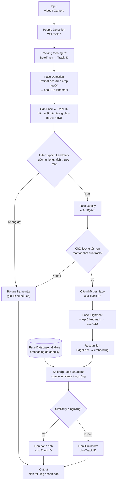

# Hệ thống nhận diện khuôn mặt và bám bắt đối tượng

## Sơ đồ luồng tổng thể

## Giải thích các khối

| Bước | Khối | Vai trò |
|------|------|---------|
| 1 | Input | Nhận khung hình từ video hoặc camera |
| 2 | People Detection (YOLOv11n) | Phát hiện người, trả về bbox |
| 3 | Tracking (ByteTrack) | Gán Track ID ổn định cho từng người |
| 4 | Face Detection (RetinaFace) | Tìm mặt trong vùng người, trả bbox + 5 landmark |
| 5 | Gán Face ↔ Track | Ghép mặt với đúng người |
| 6 | Filter landmark | Loại mặt nghiêng quá mức, quá nhỏ |
| 7 | Face Quality (eDifFIQA-T) | Chấm điểm chất lượng ảnh mặt |
| 8 | Chọn best face | Mỗi track chỉ giữ mặt chất lượng cao nhất |
| 9 | Alignment | Căn chỉnh mặt bằng 5 landmark |
| 10 | Recognition (EdgeFace) | Trích xuất embedding |
| 11 | So khớp Face DB | Cosine similarity với gallery, so với ngưỡng |
| 12 | Output | Hiển thị, lưu log, trả ID/tên |

## Điểm khác so với bản cũ

- ByteTrack chuyển lên **ngay sau People Detection** (track theo người, không phải cuối chuỗi).
- Recognition chạy **sau** Filter + Face Quality, không lấy trực tiếp từ Face Detection.
- Face Quality tách thành **khối riêng**, không gộp chung với Tracking.
- Bổ sung: **Gán Face↔Track, Best-face selection, Alignment, Face Database, Output**.
- Filter đổi sang **hình thoi** (khối quyết định).
