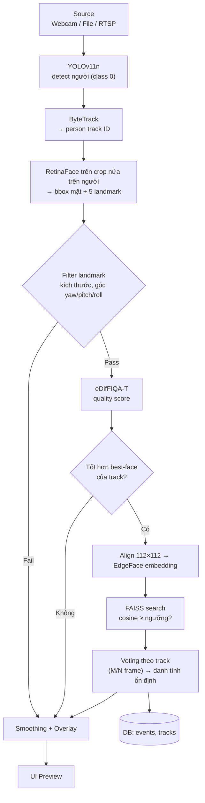
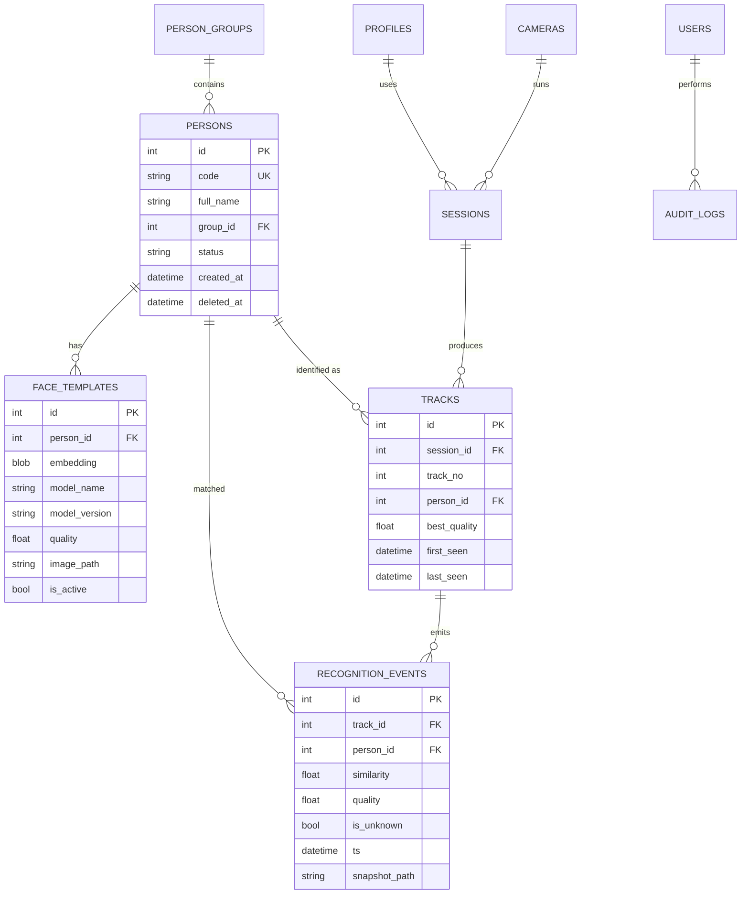
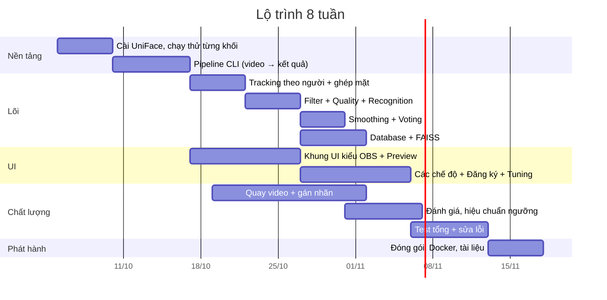

# Kế hoạch hoàn chỉnh: Hệ thống nhận diện khuôn mặt và bám bắt đối tượng

> Stack: YOLOv11n → ByteTrack → RetinaFace → Filter 5-landmark → eDifFIQA-T → EdgeFace → FAISS + DB
> Tham khảo mã nguồn: [UniFace](https://yakhyo.github.io/uniface/) (MIT License)
> UI: phong cách OBS Studio (Qt, dock panel, dark theme)

---

## Mục lục

1. [Tổng quan và phạm vi](#1-tổng-quan-và-phạm-vi)
2. [Nguồn mã (Source) và cấu trúc dự án](#2-nguồn-mã-source-và-cấu-trúc-dự-án)
3. [Pipeline chi tiết và code khung](#3-pipeline-chi-tiết-và-code-khung)
4. [Làm mượt Bounding Box và ổn định ID](#4-làm-mượt-bounding-box-và-ổn-định-id)
5. [Thiết kế Database](#5-thiết-kế-database)
6. [Thiết kế UI giống OBS](#6-thiết-kế-ui-giống-obs)
7. [Video và dữ liệu test thực tế](#7-video-và-dữ-liệu-test-thực-tế)
8. [Kế hoạch Test Case](#8-kế-hoạch-test-case)
9. [Deploy](#9-deploy)
10. [Lộ trình thực hiện](#10-lộ-trình-thực-hiện)
11. [Rủi ro và lưu ý pháp lý](#11-rủi-ro-và-lưu-ý-pháp-lý)

---

## 1. Tổng quan và phạm vi

**Mục tiêu:** nhận video/camera, phát hiện và bám theo từng người, nhận diện danh tính từ khuôn mặt tốt nhất của mỗi người, hiển thị trên giao diện dễ dùng.

**Phạm vi bản đầu (MVP):**

| Có | Chưa làm (để sau) |
|----|-------------------|
| Input: webcam, file video, RTSP | Anti-spoofing (liveness) |
| Detect người, bám ID, detect mặt | Phân tích tuổi/giới tính/cảm xúc |
| Lọc chất lượng, nhận diện, so khớp DB | Multi-camera re-identification |
| UI desktop kiểu OBS, nhiều chế độ | Web dashboard từ xa |
| Đăng ký khuôn mặt, log sự kiện | Cluster nhiều máy |

---

## 2. Nguồn mã (Source) và cấu trúc dự án

### 2.1. Nguồn từ đâu

| Khối | Nguồn | Ghi chú |
|------|-------|---------|
| Face Detection (RetinaFace, 5 landmark) | `uniface.detection` | UniFace còn có SCRFD, YOLO-face làm phương án thay thế |
| Face Recognition (EdgeFace) | `uniface.recognition` | Cùng họ với ArcFace, AdaFace, MobileFace. Kiểm tra tên lớp ở trang Recognition của UniFace |
| Face Quality (eDifFIQA-T) | `uniface.quality.EDifFIQA` | Bản T nhỏ nhất (1.7M tham số, 6.6 MB), UniFace khuyên dùng cho real-time |
| Tracking | `uniface.tracking.BYTETracker` (từ repo `yakhyo/bytetrack-tracker`) | Nhận mảng `[x1,y1,x2,y2,score]`, không phụ thuộc detector nên dùng được cho bbox người |
| Vector store | `uniface.stores.FAISS` | Cần `pip install faiss-cpu` |
| People Detection (YOLOv11n) | thư viện `ultralytics` | Kiểm tra giấy phép AGPL-3.0 nếu phát hành thương mại |
| UI | PySide6 (Qt for Python) | OBS cũng viết bằng Qt. PySide6 dùng LGPL, dễ hơn PyQt5 (GPL) |

**Cài đặt:**

```bash
python -m venv .venv && source .venv/bin/activate     # Windows: .venv\Scripts\activate
pip install "uniface[cpu]"          # hoặc "uniface[gpu]" nếu có NVIDIA CUDA
pip install faiss-cpu ultralytics PySide6 opencv-python sqlalchemy alembic pytest motmetrics
```

### 2.2. Điểm khác biệt quan trọng so với UniFace

UniFace mẫu **bám theo khuôn mặt** (đưa bbox mặt vào ByteTrack). Luồng của bạn **bám theo người** (đưa bbox người từ YOLO vào ByteTrack), sau đó mới tìm mặt trong từng người. So sánh:

| | Track theo người (đề xuất) | Track theo mặt (như UniFace mẫu) |
|---|---|---|
| Ưu | ID giữ được khi quay lưng, cúi mặt, bị che mặt. Bbox người lớn nên IoU ổn định | Đơn giản, ít khối hơn |
| Nhược | Cần bước ghép mặt ↔ người, thêm 1 model | ID mất khi không thấy mặt. Mặt nhỏ thì IoU thấp, dễ đổi ID |
| Khi nào chọn | Camera giám sát, cửa ra vào, người đi lại | Webcam chụp cận mặt, kiosk |

Gợi ý: làm **cả hai** dưới dạng một tùy chọn trong Settings (`tracking_mode = person | face`). Phần lõi dùng chung.

### 2.3. Cấu trúc thư mục

```
face_app/
├── core/                    # Logic thuần, KHÔNG phụ thuộc UI (dùng chung cho GUI và service)
│   ├── pipeline.py          # Điều phối toàn bộ luồng
│   ├── detectors.py         # Bọc YOLO + RetinaFace
│   ├── tracker.py           # Bọc BYTETracker + ghép face↔track
│   ├── quality.py           # Filter landmark + eDifFIQA
│   ├── recognizer.py        # Align + EdgeFace + so khớp
│   ├── smoothing.py         # One Euro / EMA / voting
│   ├── sources.py           # Webcam / File / RTSP reader (thread riêng)
│   └── config.py            # Dataclass cấu hình, load/save JSON
├── db/
│   ├── models.py            # SQLAlchemy models
│   ├── repo.py              # CRUD, đồng bộ FAISS
│   └── migrations/          # Alembic
├── ui/
│   ├── main_window.py       # Cửa sổ chính kiểu OBS
│   ├── docks/               # modes_dock, sources_dock, tuning_dock, controls_dock
│   ├── dialogs/             # enroll_dialog, settings_dialog, events_dialog
│   ├── video_widget.py      # Hiển thị frame + vẽ overlay
│   └── theme.qss            # Dark theme
├── service/                 # (tùy chọn) FastAPI chạy headless
├── tests/                   # unit / integration / benchmark
├── tools/                   # script đánh giá, import dataset, export metric
├── models/                  # file ONNX (cache offline)
├── data/                    # db, faiss index, snapshots
├── Dockerfile
├── docker-compose.yml
└── pyproject.toml
```

Nguyên tắc: `core/` không import gì từ `ui/`. Nhờ vậy test được pipeline không cần màn hình và deploy được bản headless.

---

## 3. Pipeline chi tiết và code khung



### 3.1. Code khung (rút gọn)

```python
# core/pipeline.py  (minh họa, cần chỉnh theo API thật của từng thư viện)
import numpy as np, cv2, time
from ultralytics import YOLO
from uniface.detection import RetinaFace
from uniface.quality import EDifFIQA
from uniface.recognition import EdgeFace          # kiểm tra tên lớp trong docs
from uniface.tracking import BYTETracker
from uniface.stores import FAISS

class Pipeline:
    def __init__(self, cfg):
        self.cfg = cfg
        self.person_det = YOLO("yolo11n.pt")
        self.face_det   = RetinaFace()
        self.quality    = EDifFIQA()
        self.recog      = EdgeFace()
        self.tracker    = BYTETracker(track_thresh=0.5, track_buffer=30, match_thresh=0.8)
        self.store      = FAISS(embedding_size=512, db_path=cfg.faiss_path)
        self.store.load()
        self.state = {}      # track_id -> TrackState (best face, votes, filters)

    def process(self, frame):
        t = time.time()
        # 1) Detect người
        r = self.person_det(frame, classes=[0], conf=self.cfg.person_conf, verbose=False)[0]
        dets = np.hstack([r.boxes.xyxy.cpu().numpy(), r.boxes.conf.cpu().numpy()[:, None]]) \
               if len(r.boxes) else np.empty((0, 5))

        # 2) Track theo người -> [x1,y1,x2,y2,track_id]
        tracks = self.tracker.update(dets)

        results = []
        for x1, y1, x2, y2, tid in tracks:
            st = self.state.setdefault(int(tid), TrackState(self.cfg))

            # 3) Detect mặt trong nửa trên của bbox người (nhanh hơn chạy cả frame)
            h = y2 - y1
            crop = frame[int(y1):int(y1 + 0.5 * h), int(x1):int(x2)]
            faces = self.face_det.detect(crop) if crop.size else []
            face = pick_largest(faces)
            if face is not None:
                face = offset_to_frame(face, int(x1), int(y1))   # đưa tọa độ về frame gốc

                # 4) Filter landmark + 5) Quality
                if landmark_ok(face.landmarks, self.cfg):
                    q = self.quality.predict(frame, face.landmarks).score
                    if q >= self.cfg.min_quality and q > st.best_quality:
                        st.best_quality = q
                        emb = self.recog.get_normalized_embedding(frame, face.landmarks)
                        meta, sim = self.store.search(emb, threshold=self.cfg.match_thr)
                        st.vote(meta["person_id"] if meta else None, sim)

            # 6) Smoothing chỉ để hiển thị
            box = st.smooth_box((x1, y1, x2, y2), t)
            results.append(TrackResult(int(tid), box, st.identity(), st.best_quality))
        self.cleanup(tracks)     # xóa state của track đã mất
        return results
```

### 3.2. Filter 5-point landmark

Với 5 điểm (mắt trái, mắt phải, mũi, khóe miệng trái, khóe miệng phải) có thể ước lượng nhanh mà không cần model thêm:

| Kiểm tra | Cách tính | Gợi ý ngưỡng ban đầu (cần tinh chỉnh) |
|----------|-----------|----------------------------------------|
| Kích thước mặt | chiều rộng bbox mặt (px) | ≥ 60–80 px |
| Yaw (quay ngang) | lệch của mũi so với trung điểm 2 mắt, chia khoảng cách 2 mắt | \|tỉ lệ\| ≤ 0.3–0.4 |
| Roll (nghiêng) | góc đường nối 2 mắt so với phương ngang | ≤ 20–25° |
| Pitch (cúi/ngẩng) | tỉ lệ khoảng cách mắt→mũi so với mũi→miệng | trong khoảng 0.6–1.6 |
| Confidence mặt | điểm RetinaFace | ≥ 0.6 |

Các con số trên chỉ là điểm khởi đầu. Hãy chỉnh bằng dữ liệu thật của bạn (mục 7 và 8).

### 3.3. Chiến lược nhận diện tiết kiệm tài nguyên

- Chỉ nhận diện khi track **chưa có danh tính** hoặc **xuất hiện mặt tốt hơn** hẳn (ví dụ `q > best + 0.1`).
- Track đã xác nhận danh tính: chỉ kiểm tra lại mỗi 1–2 giây hoặc khi đổi mặt chất lượng cao hơn.
- YOLO chạy mỗi frame, RetinaFace/quality/EdgeFace chạy theo điều kiện. Có thể giảm tần suất YOLO (mỗi 2–3 frame) và để Kalman của ByteTrack nội suy.
- Dùng `embedding trung bình` của vài frame tốt nhất thay vì 1 frame để ổn định hơn.

---

## 4. Làm mượt Bounding Box và ổn định ID

Có **3 lớp** làm mượt, nên áp dụng theo thứ tự:

| Lớp | Mục đích | Kỹ thuật |
|-----|----------|----------|
| 1. Trong tracker | Dự đoán vị trí, giữ track khi mất detect ngắn | Kalman Filter của ByteTrack (đã có). `track_buffer` giữ track bị mất |
| 2. Hậu xử lý bbox | Giảm rung (jitter) khi hiển thị | **One Euro Filter** (khuyên dùng) hoặc EMA |
| 3. Ổn định nhãn | Tránh nhãn tên chớp nháy | Voting M/N + hysteresis ngưỡng |

### 4.1. One Euro Filter

Ưu điểm so với EMA: khi đối tượng đứng yên thì lọc mạnh (hết rung), khi di chuyển nhanh thì tự giảm độ trễ. Nên lọc trên `(cx, cy, w, h)` thay vì 4 góc để tránh méo hình khi từng góc rung riêng.

```python
# core/smoothing.py
import math, numpy as np

class OneEuro:
    def __init__(self, min_cutoff=1.0, beta=0.01, d_cutoff=1.0):
        self.min_cutoff, self.beta, self.d_cutoff = min_cutoff, beta, d_cutoff
        self.x_prev = self.dx_prev = self.t_prev = None

    @staticmethod
    def _alpha(cutoff, dt):
        tau = 1.0 / (2 * math.pi * cutoff)
        return 1.0 / (1.0 + tau / dt)

    def __call__(self, x, t):
        x = np.asarray(x, dtype=float)
        if self.t_prev is None:
            self.x_prev, self.dx_prev, self.t_prev = x, np.zeros_like(x), t
            return x
        dt = max(t - self.t_prev, 1e-6)
        dx = (x - self.x_prev) / dt
        a_d = self._alpha(self.d_cutoff, dt)
        dx_hat = a_d * dx + (1 - a_d) * self.dx_prev
        cutoff = self.min_cutoff + self.beta * np.abs(dx_hat)
        a = self._alpha(cutoff, dt)
        x_hat = a * x + (1 - a) * self.x_prev
        self.x_prev, self.dx_prev, self.t_prev = x_hat, dx_hat, t
        return x_hat

def xyxy_to_cxcywh(b):
    x1, y1, x2, y2 = b
    return np.array([(x1 + x2) / 2, (y1 + y2) / 2, x2 - x1, y2 - y1])

def cxcywh_to_xyxy(c):
    cx, cy, w, h = c
    return np.array([cx - w / 2, cy - h / 2, cx + w / 2, cy + h / 2])
```

Cách chỉnh tham số:

| Hiện tượng | Chỉnh |
|-----------|-------|
| Đứng yên vẫn rung | Giảm `min_cutoff` (ví dụ 1.0 → 0.5) |
| Di chuyển nhanh bị trễ, bbox "kéo đuôi" | Tăng `beta` (ví dụ 0.01 → 0.05) |
| Kích thước bbox nhảy | Dùng bộ lọc riêng cho `w,h` với `min_cutoff` thấp hơn |

Đây là giá trị khởi đầu, `beta` phụ thuộc đơn vị pixel và FPS nên cần thử.

### 4.2. Các mẹo bổ sung

- **Giữ bbox khi mất detect ngắn:** vẫn vẽ bbox dự đoán của Kalman tối đa 5–10 frame, vẽ nét mờ/đứt để người dùng biết là ước lượng.
- **Hysteresis kích thước:** chỉ cập nhật `w,h` khi thay đổi vượt 5–8%, tránh bbox "thở".
- **NMS chặt hơn** cho YOLO để tránh 2 bbox chồng trên một người, giảm đổi ID.
- **Tách "vẽ" khỏi "tính":** bbox đã làm mượt chỉ để hiển thị, phần cắt mặt và nhận diện dùng bbox thô/Kalman.
- **Đồng bộ thời gian:** dùng timestamp thật của frame (không phải số frame) để One Euro đúng khi FPS dao động.
- **Với mặt nhỏ:** theo tài liệu UniFace, tracker dựa IoU dễ đổi ID khi mặt nhỏ. Có thể hạ `match_thresh` xuống khoảng 0.5–0.6 và tăng `track_buffer` lên 60 trở lên. Tracking theo người đã giảm vấn đề này vì bbox lớn hơn.

### 4.3. Ổn định danh tính (voting)

```python
class TrackState:
    def __init__(self, cfg):
        self.votes = []            # list (person_id | None, similarity)
        self.identity_id = None
        self.cfg = cfg

    def vote(self, pid, sim):
        self.votes = (self.votes + [(pid, sim)])[-self.cfg.vote_window:]   # ví dụ 7
        ids = [p for p, _ in self.votes if p is not None]
        if ids:
            top = max(set(ids), key=ids.count)
            if ids.count(top) >= self.cfg.vote_min:                        # ví dụ 3/7
                self.identity_id = top
        # Hysteresis: đã xác nhận thì cần bằng chứng mạnh mới đổi sang người khác
```

Gợi ý: ngưỡng chấp nhận lần đầu cao hơn ngưỡng giữ nhãn (ví dụ 0.45 vào, 0.35 giữ). UniFace dùng mặc định `threshold=0.4` cho `store.search`, hãy hiệu chuẩn lại theo mục 8.

---

## 5. Thiết kế Database

### 5.1. Nguyên tắc

- **DB quan hệ là "nguồn sự thật"** (SQLite cho dev/desktop, PostgreSQL cho nhiều người dùng/server).
- **FAISS chỉ là chỉ mục tìm kiếm** (cache). Hỏng hay đổi model thì dựng lại từ bảng `face_templates`.
- Lưu `model_name` và `model_version` cho từng embedding: embedding của EdgeFace không so sánh được với embedding của model khác.
- UniFace FAISS dùng `IndexFlatIP`, vector phải được **L2-normalize** trước khi thêm. Mỗi vector có metadata dict (ví dụ `person_id`), nên dùng `template_id` và `person_id` làm metadata để đối chiếu về DB.
- `FAISS.remove()` sẽ rebuild index nên xóa hàng loạt thì gom lại một lần.

### 5.2. Sơ đồ quan hệ



### 5.3. DDL (tương thích SQLite và PostgreSQL, cần đổi kiểu một số chỗ cho Postgres)

```sql
CREATE TABLE person_groups (
  id INTEGER PRIMARY KEY,
  name TEXT NOT NULL UNIQUE
);

CREATE TABLE persons (
  id INTEGER PRIMARY KEY,
  code TEXT NOT NULL UNIQUE,              -- mã nhân viên/học sinh
  full_name TEXT NOT NULL,
  group_id INTEGER REFERENCES person_groups(id),
  status TEXT NOT NULL DEFAULT 'active',  -- active | blocked | inactive
  notes TEXT,
  created_at TEXT NOT NULL DEFAULT CURRENT_TIMESTAMP,
  updated_at TEXT,
  deleted_at TEXT                          -- xóa mềm
);

CREATE TABLE face_templates (
  id INTEGER PRIMARY KEY,
  person_id INTEGER NOT NULL REFERENCES persons(id) ON DELETE CASCADE,
  embedding BLOB NOT NULL,                 -- float32[512], đã L2-normalize
  model_name TEXT NOT NULL,                -- 'edgeface'
  model_version TEXT NOT NULL,
  quality REAL,                            -- điểm eDifFIQA lúc đăng ký
  image_path TEXT,
  is_active INTEGER NOT NULL DEFAULT 1,
  created_at TEXT NOT NULL DEFAULT CURRENT_TIMESTAMP
);
CREATE INDEX idx_templates_person ON face_templates(person_id);

CREATE TABLE cameras (
  id INTEGER PRIMARY KEY,
  name TEXT NOT NULL,
  source_type TEXT NOT NULL,               -- webcam | file | rtsp
  uri TEXT NOT NULL,
  location TEXT,
  enabled INTEGER NOT NULL DEFAULT 1
);

CREATE TABLE profiles (                    -- giống Profile của OBS: bộ cấu hình có tên
  id INTEGER PRIMARY KEY,
  name TEXT NOT NULL UNIQUE,
  mode TEXT NOT NULL,                      -- simple | advanced | enroll | playback | monitor
  config_json TEXT NOT NULL                -- ngưỡng, tham số smoothing, ...
);

CREATE TABLE sessions (
  id INTEGER PRIMARY KEY,
  camera_id INTEGER REFERENCES cameras(id),
  profile_id INTEGER REFERENCES profiles(id),
  started_at TEXT NOT NULL,
  ended_at TEXT,
  config_snapshot TEXT                     -- cấu hình thực tế lúc chạy, để tái lập kết quả
);

CREATE TABLE tracks (
  id INTEGER PRIMARY KEY,
  session_id INTEGER NOT NULL REFERENCES sessions(id) ON DELETE CASCADE,
  track_no INTEGER NOT NULL,               -- ID do ByteTrack cấp, chỉ duy nhất trong 1 session
  person_id INTEGER REFERENCES persons(id),
  best_quality REAL,
  best_snapshot TEXT,
  first_seen TEXT NOT NULL,
  last_seen TEXT NOT NULL,
  UNIQUE (session_id, track_no)
);

CREATE TABLE recognition_events (
  id INTEGER PRIMARY KEY,
  track_id INTEGER NOT NULL REFERENCES tracks(id) ON DELETE CASCADE,
  person_id INTEGER REFERENCES persons(id),
  similarity REAL,
  quality REAL,
  is_unknown INTEGER NOT NULL DEFAULT 0,
  ts TEXT NOT NULL,
  bbox TEXT,                               -- "x1,y1,x2,y2"
  snapshot_path TEXT
);
CREATE INDEX idx_events_ts ON recognition_events(ts);
CREATE INDEX idx_events_person ON recognition_events(person_id, ts);

CREATE TABLE users (
  id INTEGER PRIMARY KEY,
  username TEXT NOT NULL UNIQUE,
  password_hash TEXT NOT NULL,             -- argon2/bcrypt, không lưu mật khẩu thô
  role TEXT NOT NULL DEFAULT 'operator'    -- admin | operator | viewer
);

CREATE TABLE audit_logs (
  id INTEGER PRIMARY KEY,
  user_id INTEGER REFERENCES users(id),
  action TEXT NOT NULL,                    -- enroll | delete_person | export | change_threshold ...
  target TEXT,
  ts TEXT NOT NULL DEFAULT CURRENT_TIMESTAMP
);
```

### 5.4. Quy tắc vận hành dữ liệu

| Chủ đề | Quy tắc |
|--------|---------|
| Ghi sự kiện | Không ghi mỗi frame. Ghi khi: track mới xác nhận danh tính, đổi danh tính, hoặc track kết thúc. Dùng hàng đợi ghi bất đồng bộ để không làm chậm pipeline |
| Snapshot | Lưu file ảnh mặt vào `data/snapshots/`, DB chỉ lưu đường dẫn. Mã hóa hoặc phân quyền thư mục |
| Đồng bộ FAISS | Khi thêm/xóa `face_templates`: cập nhật DB trước, rồi FAISS, rồi `save()`. Khởi động app: so số vector FAISS với số template active, lệch thì dựng lại |
| Đổi model | Thêm template mới với `model_version` mới, chạy song song, rồi chuyển. Không trộn các phiên bản trong một index |
| Lưu trữ | Đặt thời hạn xóa tự động cho `recognition_events` và snapshot (ví dụ 30–90 ngày), tùy chính sách |
| Sao lưu | Sao lưu DB + thư mục faiss + snapshot theo lịch |

---

## 6. Thiết kế UI giống OBS

### 6.1. Ánh xạ từ OBS sang ứng dụng của bạn

Từ ảnh OBS bạn gửi, bố cục gồm: thanh menu, vùng Preview lớn ở giữa, hàng dock bên dưới (Scenes, Sources, Mixer, Controls), thanh trạng thái hiển thị LIVE/REC/CPU/FPS. Ánh xạ:

| OBS | Ứng dụng của bạn | Ý nghĩa |
|-----|------------------|---------|
| Preview | **Preview video** + overlay bbox, ID, tên, quality | Vùng chính |
| Scenes | **Chế độ (Modes)** | Chọn nhanh: Đơn giản / Nâng cao / Đăng ký / Test / Giám sát |
| Sources | **Nguồn (Sources)** | Webcam, file video, RTSP. Thêm/xóa/sắp xếp bằng nút +, −, ⚙ như OBS |
| Mixer (thanh trượt âm lượng) | **Tinh chỉnh (Tuning)** | Thanh trượt: ngưỡng nhận diện, quality tối thiểu, độ mượt bbox, ngưỡng góc mặt |
| Scene Transitions | **Hiển thị (Overlay)** | Chọn lớp hiển thị: bbox, landmark, ID, điểm quality, tên |
| Start Streaming / Start Recording | **Bắt đầu nhận diện / Ghi hình** | Nút điều khiển chính |
| Studio Mode | **So sánh A/B** | Xem song song: chưa làm mượt vs đã làm mượt, hoặc 2 bộ ngưỡng |
| Settings / Exit | **Cài đặt / Thoát** | |
| Profile | **Profile** | Bộ cấu hình có tên, lưu vào bảng `profiles` |
| Scene Collection | **Kịch bản (Scenario)** | Tập hợp nguồn + chế độ lưu lại |
| Status bar: LIVE, REC, CPU, fps | **RUN, REC, FPS, CPU/GPU, số Track, độ trễ** | |

### 6.2. Wireframe

```
┌──────────────────────────────────────────────────────────────────────────────┐
│ Tệp  Chỉnh sửa  Xem  Profile  Kịch bản  Công cụ  Trợ giúp                    │
├──────────────────────────────────────────────────────────────────────────────┤
│                                                                              │
│                  ┌──────────────────────────────────────┐                    │
│                  │                                      │                    │
│                  │         PREVIEW VIDEO                │                    │
│                  │   ┌────────┐ #12 Nguyễn Văn A  0.62   │                    │
│                  │   │  mặt   │ #14 Unknown        0.41  │                    │
│                  │   └────────┘                          │                    │
│                  └──────────────────────────────────────┘                    │
│                                                                              │
├───────────────┬───────────────┬──────────────────────────┬───────────┬───────┤
│ Chế độ        │ Nguồn         │ Tinh chỉnh               │ Hiển thị  │Điều   │
│ ● Đơn giản    │ ☑ Webcam 0    │ Ngưỡng nhận diện  ──●── │ ☑ Bbox    │khiển  │
│ ○ Nâng cao    │ ☐ video.mp4   │ Quality tối thiểu ─●──── │ ☑ ID/Tên  │       │
│ ○ Đăng ký     │ ☐ rtsp://...  │ Độ mượt bbox      ───●── │ ☐ Landmark│[Bắt   │
│ ○ Test video  │               │ Góc mặt tối đa    ──●─── │ ☐ Quality │ đầu]  │
│ ○ Giám sát    │ + − ⚙ ▲ ▼    │                          │           │[Ghi]  │
│ + −           │               │                          │           │[Đăng  │
│               │               │                          │           │ ký]   │
│               │               │                          │           │[Cài   │
│               │               │                          │           │ đặt]  │
├───────────────┴───────────────┴──────────────────────────┴───────────┴───────┤
│ RUN 00:03:21 │ REC 00:00:00 │ FPS 24.8 │ CPU 38% │ GPU 21% │ Tracks 3 │ 41ms │
└──────────────────────────────────────────────────────────────────────────────┘
```

### 6.3. Các chế độ cho người dùng

| Chế độ | Dành cho | Hiển thị | Hành vi |
|--------|----------|----------|---------|
| **Đơn giản** | Người mới | Chỉ Preview + nút Bắt đầu + chọn nguồn. Ẩn các slider | Dùng preset sẵn có, tự chọn tham số hợp lý |
| **Nâng cao** | Kỹ thuật viên | Đủ slider, landmark, quality, FPS từng khối, log | Chỉnh mọi ngưỡng, xem số liệu từng bước |
| **Đăng ký** | Quản trị | Khung hướng dẫn "nhìn thẳng, quay trái, quay phải", thanh tiến độ | Chụp N frame, chọn best-of-N theo eDifFIQA (UniFace có sẵn mẫu), lưu 3–5 template/người |
| **Test video** | Dev/QA | Thanh tua, tốc độ phát, nút xuất metric | Chạy file video, đánh dấu ground truth, xuất CSV (IDF1, ID switch, FPS) |
| **Giám sát** | Vận hành | Toàn màn hình, danh sách sự kiện bên cạnh, cảnh báo | Khóa cài đặt, ghi log, cảnh báo Unknown/blocked |
| **Riêng tư** (tùy chọn) | Demo công khai | Làm mờ mặt Unknown | UniFace có module Privacy với 5 kiểu blur |

### 6.4. Nguyên tắc kỹ thuật cho UI

- **PySide6 + QDockWidget**: mỗi panel là một dock, kéo thả/ẩn/hiện/tách rời giống OBS. Lưu bố cục bằng `saveState()` / `restoreState()`.
- **Dark theme** bằng file `.qss` (nền xám đậm, nút chính xanh dương như OBS).
- **Pipeline chạy trong thread riêng** (`QThread` hoặc `multiprocessing`), gửi frame + kết quả qua signal. Hàng đợi chỉ giữ frame mới nhất (bỏ frame cũ) để UI không bị trễ tích lũy.
- **Vẽ overlay bằng QPainter** trên frame, hoặc vẽ bằng OpenCV rồi chuyển sang `QImage`. Bản MVP dùng cách thứ hai cho nhanh.
- **Slider thay đổi tham số theo thời gian thực** thông qua đối tượng `config` dùng chung (có khóa), không cần khởi động lại pipeline.
- **Trạng thái rõ ràng:** nút Bắt đầu/Dừng đổi màu, thông báo lỗi nguồn (mất camera) bằng banner, tự kết nối lại.
- **Dễ tiếp cận:** phím tắt (Space bắt đầu/dừng, R ghi, E đăng ký), tooltip tiếng Việt cho từng slider, nút "Khôi phục mặc định", hỗ trợ đổi cỡ chữ.
- **Lần chạy đầu:** hộp thoại hướng dẫn 3 bước (chọn nguồn → đăng ký 1 người → bắt đầu).

---

## 7. Video và dữ liệu test thực tế

### 7.1. Ba nguồn dữ liệu

| Nguồn | Dùng để | Ghi chú |
|-------|---------|---------|
| **A. Tự quay** (quan trọng nhất) | Đánh giá đúng môi trường triển khai thật | Cần sự đồng ý bằng văn bản của người tham gia vì đây là dữ liệu sinh trắc học |
| **B. Dataset công khai** | So sánh khách quan, tái lập | Kiểm tra giấy phép và điều khoản từng dataset trước khi dùng |
| **C. Video stock miễn phí** (Pexels, Pixabay...) | Demo, test đám đông, không có nhãn danh tính | Chỉ dùng được cho test định tính |

### 7.2. Dataset công khai gợi ý

| Mục đích | Dataset | Ghi chú |
|----------|---------|---------|
| Người đi bộ + tracking (video có nhãn ID) | **MOT17 / MOT20** (MOTChallenge) | Chuẩn để đo IDF1, MOTA, ID switch cho khối YOLO + ByteTrack. Chỉ có người, không có danh tính mặt |
| Detect mặt | **WIDER FACE** (val) | Dùng đánh giá RetinaFace. UniFace liệt kê cả bộ này và cách tải |
| Nhận diện (verification) | **LFW, CALFW, CPLFW, AgeDB-30, CFP-FP** | UniFace cung cấp bản đã căn chỉnh 112×112 trên Kaggle (`agedb-30-calfw-cplfw-lfw-aligned-112x112`). Dùng chọn ngưỡng cosine |
| Nhận diện cấp độ cao | IJB-B, IJB-C | Cần đăng ký xin quyền truy cập |
| Video mặt người đi qua cổng | **ChokePoint** (nếu còn tải được) | Gần với kịch bản camera cửa ra vào. Cần kiểm tra lại nguồn và giấy phép |
| Video mặt từ YouTube | YouTube Faces DB | Kiểm tra điều kiện sử dụng |

Mình chỉ xác minh được danh sách dataset trên trang Datasets của UniFace. Các link và điều khoản của MOTChallenge, ChokePoint, YouTube Faces bạn nên tự kiểm tra lại trước khi dùng.

### 7.3. Kế hoạch tự quay video (bộ test tối thiểu)

Quay bằng chính camera sẽ triển khai, 1080p, 25–30 FPS, mỗi cảnh 1–3 phút. Nhờ 5–10 tình nguyện viên.

| # | Kịch bản | Mục đích |
|---|----------|----------|
| V01 | 1 người đi thẳng vào camera, 2m → 5m | Cơ bản |
| V02 | 1 người đứng yên 30 giây | Đo độ rung bbox |
| V03 | 1 người quay đầu trái/phải/cúi/ngẩng | Test filter landmark |
| V04 | 3–5 người đi lại, giao cắt nhau | Test đổi ID |
| V05 | Người bị che bởi người khác/vật cản rồi xuất hiện lại | Test giữ ID |
| V06 | Ngược sáng, tối, ánh sáng đèn vàng | Test chất lượng |
| V07 | Đeo khẩu trang, kính, mũ | Test độ bền nhận diện |
| V08 | Khoảng cách xa 8–10m | Test mặt nhỏ |
| V09 | Người lạ (không đăng ký) đi vào | Test Unknown, đo False Accept |
| V10 | Chạy liên tục 1–2 giờ | Test ổn định, rò rỉ bộ nhớ |

**Gán nhãn (ground truth):** dùng CVAT hoặc Label Studio để gán ID người cho từng bbox ở một số frame mẫu (ví dụ mỗi 10 frame). Từ đó tính được IDF1, ID switch bằng `motmetrics` hoặc TrackEval.

---

## 8. Kế hoạch Test Case

### 8.1. Chỉ số đánh giá

| Nhóm | Chỉ số |
|------|--------|
| Detect | Recall/Precision người (MOT), Recall mặt trên WIDER FACE val |
| Tracking | IDF1, MOTA, số lần đổi ID (ID switch), số lần mất track |
| Nhận diện | TAR@FAR, FAR, FRR, Rank-1 accuracy, tỉ lệ Unknown nhận nhầm thành người quen |
| Hiệu năng | FPS tổng, độ trễ từng khối (ms), RAM/VRAM, CPU/GPU |
| Độ mượt | Độ lệch chuẩn của tâm bbox khi người đứng yên (px), độ trễ bbox so với thực tế |

Mục tiêu số cụ thể (ví dụ FAR ≤ 0.1%, FPS ≥ 15) nên đặt sau khi đo baseline trên phần cứng thật của bạn.

### 8.2. Unit test

| ID | Đối tượng | Mô tả | Kỳ vọng |
|----|-----------|-------|---------|
| UT-01 | `landmark_ok` | Landmark mặt thẳng | Pass |
| UT-02 | `landmark_ok` | Landmark yaw 60° | Fail |
| UT-03 | `landmark_ok` | Mặt rộng < ngưỡng | Fail |
| UT-04 | `OneEuro` | Chuỗi điểm nhiễu quanh một vị trí | Độ lệch chuẩn đầu ra nhỏ hơn đầu vào |
| UT-05 | `OneEuro` | Điểm di chuyển đều nhanh | Độ trễ nhỏ hơn ngưỡng đặt |
| UT-06 | `TrackState.vote` | 3/7 phiếu cùng một ID | Xác nhận danh tính |
| UT-07 | `TrackState.vote` | Phiếu xen kẽ A,B,A,B | Không xác nhận (hoặc giữ nhãn cũ) |
| UT-08 | `offset_to_frame` | Mặt trong crop → tọa độ frame | Đúng tọa độ gốc |
| UT-09 | Embedding | Sau chuẩn hóa, độ dài = 1 | \|norm − 1\| < 1e-5 |
| UT-10 | Repo DB | Thêm/xóa template | DB và FAISS khớp số lượng |

### 8.3. Integration test

| ID | Kịch bản | Kỳ vọng |
|----|----------|---------|
| IT-01 | Ảnh người đã đăng ký → pipeline | Nhận đúng person_id |
| IT-02 | Ảnh người chưa đăng ký | Trả về Unknown |
| IT-03 | Frame không có người | Không lỗi, trả danh sách rỗng |
| IT-04 | Mặt bị crop sát mép frame | Không crash, tọa độ hợp lệ |
| IT-05 | Đăng ký → tắt app → mở lại | Nhận lại được (index được load) |
| IT-06 | Xóa người → FAISS rebuild | Người đó không còn được nhận diện |
| IT-07 | Rút camera giữa chừng | UI báo lỗi, tự kết nối lại |
| IT-08 | Đổi slider ngưỡng khi đang chạy | Áp dụng ngay, không crash |
| IT-09 | Ghi sự kiện DB | Chỉ ghi khi đổi trạng thái, không ghi mỗi frame |
| IT-10 | Chuyển giữa các chế độ | Giữ nguồn, đổi bố cục/tham số đúng |

### 8.4. Test độ chính xác (dùng video mục 7)

| ID | Video | Chỉ số | Cách đo |
|----|-------|--------|---------|
| AC-01 | MOT17/20 | IDF1, MOTA, ID switch | So sánh với ground truth bằng motmetrics |
| AC-02 | V04, V05 | ID switch | Đếm lần đổi ID so với nhãn |
| AC-03 | LFW/CALFW/CPLFW/AgeDB/CFP-FP | Accuracy, TAR@FAR | Quét ngưỡng cosine, chọn ngưỡng vận hành |
| AC-04 | V09 | FAR | Số lần người lạ bị nhận thành người quen / tổng lượt |
| AC-05 | V01–V03 | FRR | Số lần người quen bị bỏ sót / tổng lượt |
| AC-06 | V06, V07, V08 | Rank-1 theo điều kiện | Báo cáo riêng từng điều kiện |
| AC-07 | V02 | Độ rung bbox | Độ lệch chuẩn tâm bbox, so có/không One Euro |

### 8.5. Test hiệu năng và độ bền

| ID | Nội dung | Kỳ vọng |
|----|----------|---------|
| PF-01 | Đo ms từng khối trên CPU và GPU | Có bảng baseline, xác định điểm nghẽn |
| PF-02 | 1, 3, 5, 10 người cùng lúc | FPS giảm có kiểm soát |
| PF-03 | Chạy liên tục 2–8 giờ | RAM không tăng đều (không rò rỉ), không crash |
| PF-04 | `state` của track đã mất | Được dọn, kích thước dict không tăng vô hạn |
| PF-05 | DB 10.000 template | Thời gian tìm kiếm FAISS vẫn nhỏ so với 1 frame |
| PF-06 | RTSP mất mạng 30 giây | Tự phục hồi |

### 8.6. Test UI/UX

| ID | Nội dung |
|----|----------|
| UX-01 | Người chưa từng dùng hoàn thành "chọn nguồn → đăng ký → bắt đầu" trong ≤ 3 phút không cần hướng dẫn |
| UX-02 | Chế độ Đơn giản không hiện slider kỹ thuật |
| UX-03 | Lưu/khôi phục bố cục dock sau khi mở lại |
| UX-04 | Phím tắt hoạt động |
| UX-05 | Thu nhỏ cửa sổ không làm vỡ bố cục, độ phân giải 1366×768 vẫn dùng được |

### 8.7. Test bảo mật và quyền riêng tư

| ID | Nội dung |
|----|----------|
| SC-01 | Vai trò `viewer` không xóa/xuất dữ liệu được |
| SC-02 | Mọi thao tác nhạy cảm có ghi `audit_logs` |
| SC-03 | Thư mục snapshot và DB có phân quyền hệ điều hành |
| SC-04 | Tự động xóa sự kiện quá hạn lưu trữ |
| SC-05 | Mật khẩu lưu dạng băm, không lưu thô |

### 8.8. Tự động hóa

```bash
pytest tests/unit tests/integration -q
python tools/eval_recognition.py --dataset data/eval/lfw_112 --out reports/rec.csv
python tools/eval_tracking.py --gt data/mot/gt --pred reports/tracks --out reports/mot.csv
python tools/benchmark.py --video data/videos/V04.mp4 --out reports/perf.csv
```

CI (GitHub Actions) chạy unit + integration trên mỗi commit. Benchmark nặng chạy thủ công hoặc theo lịch.

---

## 9. Deploy

### 9.1. Chọn phương án theo nhu cầu

| Phương án | Khi nào dùng | Cách làm |
|-----------|--------------|----------|
| **A. Ứng dụng desktop** (giống OBS) | Người dùng cuối cài trên máy | Đóng gói bằng PyInstaller (Windows/Linux). Có UI |
| **B. Service headless** | Chạy server, camera IP, không cần màn hình | Docker + FastAPI, UI web hoặc client riêng gọi API |
| **C. Edge device** | Jetson, mini PC cạnh camera | ONNX Runtime với provider phù hợp. EdgeFace thiết kế cho thiết bị biên |

Với bản đầu, nên làm **A** trước (phục vụ UI kiểu OBS), giữ `core/` tách biệt để sau này làm **B** mà không viết lại.

### 9.2. Tăng tốc phần cứng

UniFace chạy trên ONNX Runtime, tự dùng tăng tốc theo phần cứng (CUDA cho NVIDIA, Apple Silicon, CPU). Cài `uniface[gpu]` khi có NVIDIA CUDA. Với YOLO (ultralytics) có thể xuất sang ONNX để dùng chung runtime. Sau khi chạy được, mới cân nhắc TensorRT hoặc OpenVINO.

### 9.3. Chạy offline

Tải trước các model ONNX vào thư mục `models/` (UniFace có hướng dẫn "Model Cache" cho chế độ offline) để máy triển khai không cần Internet.

### 9.4. Đóng gói desktop

```bash
pip install pyinstaller
pyinstaller --noconfirm --windowed --name FaceApp \
  --add-data "models;models" --add-data "ui/theme.qss;ui" \
  ui/main.py
```

(Trên Linux dùng `:` thay cho `;` trong `--add-data`.) Kiểm tra trên máy sạch, chưa cài Python.

### 9.5. Docker cho service headless

```dockerfile
FROM python:3.11-slim
RUN apt-get update && apt-get install -y --no-install-recommends \
    libgl1 libglib2.0-0 && rm -rf /var/lib/apt/lists/*
WORKDIR /app
COPY pyproject.toml .
RUN pip install --no-cache-dir "uniface[cpu]" faiss-cpu ultralytics \
    sqlalchemy fastapi uvicorn psycopg2-binary
COPY core/ core/
COPY db/ db/
COPY service/ service/
COPY models/ models/
CMD ["uvicorn", "service.main:app", "--host", "0.0.0.0", "--port", "8000"]
```

```yaml
# docker-compose.yml
services:
  app:
    build: .
    ports: ["8000:8000"]
    volumes:
      - ./data:/app/data
    environment:
      DATABASE_URL: postgresql://face:face@db:5432/face
    depends_on: [db]
  db:
    image: postgres:16
    environment:
      POSTGRES_USER: face
      POSTGRES_PASSWORD: face     # đổi mật khẩu khi triển khai thật
      POSTGRES_DB: face
    volumes:
      - pgdata:/var/lib/postgresql/data
volumes:
  pgdata:
```

Docker dùng cho service headless. App GUI Qt nên chạy native trên máy người dùng, không đóng trong container.

### 9.6. Quy trình phát hành

1. Gắn tag phiên bản → CI chạy test → build bản PyInstaller / image Docker.
2. Dùng **Alembic** để migrate DB giữa các phiên bản.
3. Ghi `model_version` và `config_snapshot` vào DB để truy vết kết quả.
4. Có kênh log (`logging` + file xoay vòng) và nút "Xuất báo cáo lỗi" trong UI.

---

## 10. Lộ trình thực hiện



| Mốc | Kết quả bàn giao |
|-----|------------------|
| Tuần 2 | Script chạy được toàn luồng trên 1 video, in kết quả ra console |
| Tuần 4 | Có DB + đăng ký người + nhận diện đúng trên video test đơn giản |
| Tuần 6 | UI kiểu OBS chạy được 3 chế độ cơ bản, bbox đã mượt |
| Tuần 7 | Báo cáo đánh giá (IDF1, FAR/FRR, FPS), đã chọn ngưỡng vận hành |
| Tuần 8 | Bản cài đặt, tài liệu, demo |

---

## 11. Rủi ro và lưu ý pháp lý

| Rủi ro | Giảm thiểu |
|--------|-----------|
| Đổi ID khi giao cắt/che khuất | Track theo người, tăng `track_buffer`, gán lại bằng embedding khi xuất hiện lại (bước nâng cao) |
| Nhận nhầm người lạ thành người quen | Ngưỡng vào cao + voting + chỉ nhận diện khi quality đủ tốt |
| Mặt nhỏ, xa camera | Tăng độ phân giải nguồn, crop vùng quan tâm, đặt camera đúng tầm |
| Nhận diện bằng ảnh in/màn hình (giả mạo) | Chưa có anti-spoofing ở MVP. UniFace có module MiniFASNet để thêm sau |
| Thiên lệch giữa các nhóm người | Test với dữ liệu đa dạng, báo cáo độ chính xác theo nhóm |
| Giấy phép phần mềm | Kiểm tra AGPL-3.0 của ultralytics nếu phát hành thương mại. UniFace là MIT. Kiểm tra giấy phép từng model/weights và dataset |
| Dữ liệu sinh trắc học | Xin sự đồng ý rõ ràng, mã hóa, phân quyền, đặt thời hạn lưu |

**Về pháp lý:** dữ liệu khuôn mặt là dữ liệu cá nhân nhạy cảm. Nếu triển khai tại Việt Nam, bạn nên tìm hiểu Nghị định 13/2023/NĐ-CP về bảo vệ dữ liệu cá nhân và các quy định liên quan (đồng ý của chủ thể, thông báo mục đích, thời hạn lưu, biện pháp bảo vệ). Mình không phải luật sư, bạn nên hỏi chuyên gia pháp lý trước khi đưa vào sử dụng thực tế.

---

## Phụ lục: Việc cần quyết định sớm

1. Triển khai ở đâu: máy tính để bàn, server, hay thiết bị biên? (quyết định GPU/CPU, Docker hay PyInstaller)
2. Bao nhiêu người trong DB (hàng chục, trăm, hay hàng nghìn)? (quyết định SQLite hay PostgreSQL)
3. Camera tầm gần (kiosk) hay giám sát xa? (quyết định tracking theo người hay theo mặt)
4. Cần chạy nhiều camera cùng lúc không? (ảnh hưởng kiến trúc thread/process)
5. Có yêu cầu chống giả mạo (liveness) không?
