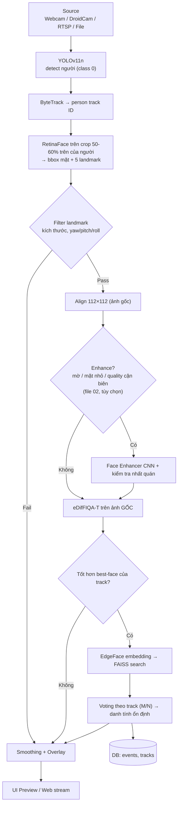
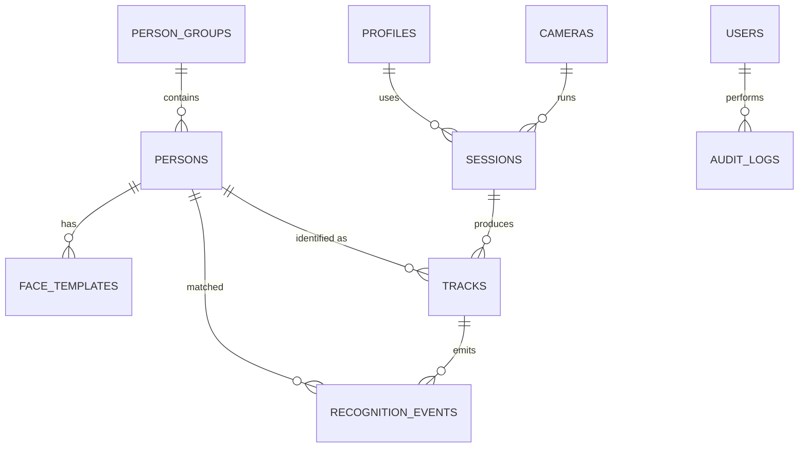
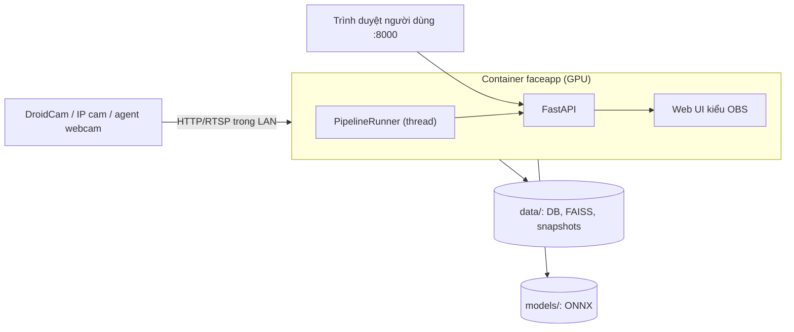
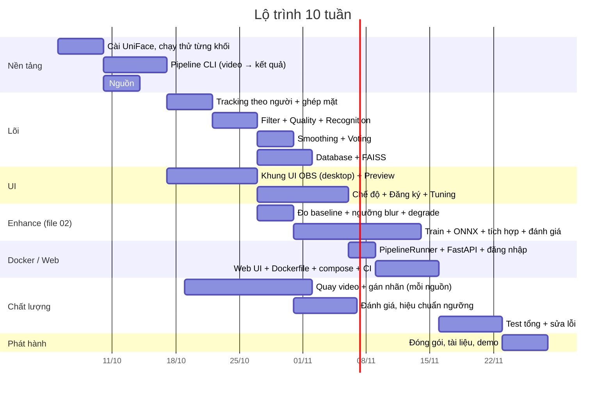

# Kế hoạch hoàn chỉnh v2: Hệ thống nhận diện khuôn mặt và bám bắt đối tượng

> Stack lõi: YOLOv11n → ByteTrack → RetinaFace → Filter 5-landmark → eDifFIQA-T → EdgeFace → FAISS + DB
> Module tùy chọn: **Face Enhancer (CNN)**, xem file riêng `02_module_enhance_cnn.md`
> Tham khảo mã nguồn: [UniFace](https://yakhyo.github.io/uniface/) (MIT License)
> UI: bản desktop PySide6 kiểu OBS Studio + bản web (Docker) cho người dùng khác
> Phần cứng phát triển: laptop i7-11850H, GPU NVIDIA RTX A2000 4GB. Cự ly camera → người: 2m đến 2.4m

Mọi con số ngưỡng, VRAM, FPS trong tài liệu là **ước tính hoặc điểm khởi đầu**, phải đo lại bằng benchmark và video thật.

---

## Mục lục

1. [Tổng quan, phạm vi, ràng buộc](#1-tổng-quan-phạm-vi-ràng-buộc)
2. [Nguồn mã và cấu trúc dự án](#2-nguồn-mã-và-cấu-trúc-dự-án)
3. [Pipeline chi tiết](#3-pipeline-chi-tiết)
4. [Làm mượt bbox và ổn định ID](#4-làm-mượt-bbox-và-ổn-định-id)
5. [Thiết kế Database](#5-thiết-kế-database)
6. [Nguồn video: Webcam, DroidCam, Cam từ xa](#6-nguồn-video-webcam-droidcam-cam-từ-xa)
7. [Thiết kế UI](#7-thiết-kế-ui)
8. [Dữ liệu test](#8-dữ-liệu-test)
9. [Kế hoạch Test Case](#9-kế-hoạch-test-case)
10. [Deploy: Desktop và Docker](#10-deploy-desktop-và-docker)
11. [Lộ trình](#11-lộ-trình)
12. [Rủi ro và pháp lý](#12-rủi-ro-và-pháp-lý)
13. [Việc cần quyết định sớm](#13-việc-cần-quyết-định-sớm)

---

## 1. Tổng quan, phạm vi, ràng buộc

**Mục tiêu:** nhận video/camera, phát hiện và bám theo từng người, nhận diện danh tính từ khuôn mặt tốt nhất của mỗi người, hiển thị trên giao diện dễ dùng.

| Có (MVP) | Chưa làm (để sau) |
|----------|-------------------|
| Input: webcam, DroidCam, cam từ xa (RTSP), file video | Anti-spoofing (liveness) |
| Detect người, bám ID, detect mặt | Phân tích tuổi/giới tính/cảm xúc |
| Lọc chất lượng, nhận diện, so khớp DB | Multi-camera re-identification |
| UI desktop kiểu OBS, nhiều chế độ | Cluster nhiều máy |
| Bản Docker: service + web UI cho người dùng khác | Edge (Jetson) xử lý tại cam |
| Module Enhance (file riêng), bật/tắt được | |

### 1.1. Ràng buộc phần cứng và cự ly

**Cự ly 2-2.4m, kích thước mặt trên ảnh (ước tính, mặt rộng ~15 cm):**

| Camera | Mặt ở 2m | Mặt ở 2.4m |
|---|---|---|
| 1080p, FOV ngang ~70° | ~100 px | ~85 px |
| 1080p, góc rộng ~90° | ~72 px | ~60 px |
| 720p, FOV ~70° | ~68 px | ~57 px |

Hệ quả: nên dùng **1080p, FOV 60-80°**. Mặt đủ lớn nên không cần phóng to, vấn đề chính là motion blur, thiếu sáng, lấy nét.

**Ngân sách VRAM 4GB (ước tính):**

| Thành phần | VRAM |
|---|---|
| YOLO11n (FP16, 640) | 0.3-0.6 GB |
| RetinaFace + eDifFIQA-T + EdgeFace (ONNX) | ~0.3-0.5 GB |
| Face Enhancer (~0.35M tham số) | <0.1 GB |
| CUDA context, buffer, Qt | ~0.5-1 GB |

Tổng khoảng 1.5-2.5 GB, vừa 4GB. Lời khuyên:
- YOLO chạy `half=True`, hoặc xuất ONNX để dùng chung runtime với UniFace.
- Cài `onnxruntime-gpu`, kiểm tra `ort.get_available_providers()` có CUDA, tránh âm thầm chạy CPU.
- i7-11850H (8 nhân) lo đọc/giải mã video, ByteTrack, FAISS, vẽ overlay, UI.
- Laptop dễ throttle nhiệt: test khi cắm sạc, chế độ hiệu năng cao, chạy PF-03 (2-8 giờ).

---

## 2. Nguồn mã và cấu trúc dự án

### 2.1. Nguồn từ đâu

| Khối | Nguồn | Ghi chú |
|------|-------|---------|
| Face Detection (RetinaFace, 5 landmark) | `uniface.detection` | Có SCRFD, YOLO-face làm phương án thay |
| Face Recognition (EdgeFace) | `uniface.recognition` | Kiểm tra tên lớp ở trang Recognition của UniFace |
| Face Quality (eDifFIQA-T) | `uniface.quality.EDifFIQA` | Bản T nhỏ nhất, hợp real-time |
| Tracking | `uniface.tracking.BYTETracker` | Nhận `[x1,y1,x2,y2,score]`, không phụ thuộc detector nên dùng được cho bbox người |
| Vector store | `uniface.stores.FAISS` | `pip install faiss-cpu` |
| People Detection (YOLOv11n) | `ultralytics` | **AGPL-3.0**, kiểm tra khi phát hành/chia sẻ image |
| UI desktop | PySide6 | LGPL |
| Service/Web | FastAPI + web UI | Dùng cho Docker |

```bash
python -m venv .venv && source .venv/bin/activate     # Windows: .venv\Scripts\activate
pip install "uniface[gpu]"            # NVIDIA CUDA; không GPU: "uniface[cpu]"
pip install faiss-cpu ultralytics PySide6 opencv-python sqlalchemy alembic pytest motmetrics
```

Các tên hàm/lớp trong code khung là **giả định**, cần nối với API thật của từng thư viện.

### 2.2. Track theo người hay theo mặt

UniFace mẫu bám theo mặt. Luồng này bám theo **người** (bbox người từ YOLO vào ByteTrack), rồi tìm mặt trong từng người.

| | Track theo người | Track theo mặt |
|---|---|---|
| Ưu | ID giữ được khi quay lưng, cúi mặt, che mặt. Bbox lớn nên IoU ổn định | Đơn giản, ít khối |
| Nhược | Cần ghép mặt ↔ người | ID mất khi không thấy mặt, mặt nhỏ dễ đổi ID |
| Khi nào | Giám sát, cửa ra vào | Kiosk, cận mặt |

Ở cự ly 2-2.4m, camera thường **không thấy toàn thân** (chỉ từ ngực/đùi lên), bbox người bị cắt và đổi theo tư thế. Cự ly này nằm giữa hai kiểu, nên **giữ cả hai** (`tracking_mode = person | face`) và so IDF1 trên video V04/V05 để chọn. Crop tìm mặt nên dùng **nửa trên đến 60%** bbox người.

### 2.3. Cấu trúc thư mục

```
face_app/
├── core/                    # Logic thuần, KHÔNG import ui/ hay service/
│   ├── pipeline.py
│   ├── detectors.py
│   ├── tracker.py
│   ├── quality.py           # Filter landmark + eDifFIQA
│   ├── recognizer.py
│   ├── enhancer.py          # Module Enhance (xem file 02)
│   ├── smoothing.py         # One Euro / voting
│   ├── sources.py           # Webcam / Stream (DroidCam, RTSP) / File
│   ├── runner.py            # PipelineRunner: chạy pipeline trong thread
│   └── config.py
├── db/                      # models.py, repo.py, migrations/ (Alembic)
├── ui/                      # PySide6 desktop: main_window, docks/, dialogs/, theme.qss
├── service/                 # FastAPI: main.py, auth.py
├── web/                     # Web UI kiểu OBS (cho Docker)
├── tests/                   # unit / integration / benchmark
├── tools/                   # eval, measure_blur, enhance/ (train, degrade, ...)
├── models/                  # ONNX (cache offline)
├── data/                    # db, faiss index, snapshots
├── Dockerfile.gpu / Dockerfile.cpu
├── docker-compose.yml
├── .env.example
└── pyproject.toml
```

`core/` dùng chung cho desktop và service. Nhờ vậy test pipeline không cần màn hình và deploy được bản headless.

---

## 3. Pipeline chi tiết



### 3.1. Code khung

```python
# core/pipeline.py  (minh họa, chỉnh theo API thật)
import numpy as np, time
from ultralytics import YOLO
from uniface.detection import RetinaFace
from uniface.quality import EDifFIQA
from uniface.recognition import EdgeFace          # kiểm tra tên lớp trong docs
from uniface.tracking import BYTETracker
from uniface.stores import FAISS

class Pipeline:
    def __init__(self, cfg, enhancer=None):
        self.cfg, self.enhancer = cfg, enhancer
        self.person_det = YOLO("yolo11n.pt")
        self.face_det   = RetinaFace()
        self.quality    = EDifFIQA()
        self.recog      = EdgeFace()
        self.tracker    = BYTETracker(track_thresh=0.5, track_buffer=30, match_thresh=0.8)
        self.store      = FAISS(embedding_size=512, db_path=cfg.faiss_path)
        self.store.load()
        self.state = {}                           # track_id -> TrackState

    def process(self, frame, ts):
        r = self.person_det(frame, classes=[0], conf=self.cfg.person_conf,
                            half=True, verbose=False)[0]
        dets = (np.hstack([r.boxes.xyxy.cpu().numpy(), r.boxes.conf.cpu().numpy()[:, None]])
                if len(r.boxes) else np.empty((0, 5)))
        tracks = self.tracker.update(dets)        # [x1,y1,x2,y2,track_id]

        results = []
        for x1, y1, x2, y2, tid in tracks:
            st = self.state.setdefault(int(tid), TrackState(self.cfg))
            h = y2 - y1
            crop = frame[int(y1):int(y1 + 0.6 * h), int(x1):int(x2)]
            faces = self.face_det.detect(crop) if crop.size else []
            face = pick_largest(faces)
            if face is not None:
                face = offset_to_frame(face, int(x1), int(y1))
                if landmark_ok(face.landmarks, self.cfg):
                    aligned = align_112(frame, face.landmarks)
                    emb, enhanced = self.embed_with_optional_enhance(aligned, face)
                    q = self.quality.score_aligned(aligned)      # chấm trên ảnh GỐC
                    if q >= self.cfg.min_quality and q > st.best_quality:
                        st.best_quality = q
                        thr = self.cfg.match_thr + (self.cfg.enhance_extra_match_thr if enhanced else 0)
                        meta, sim = self.store.search(emb, threshold=thr)
                        st.vote(meta["person_id"] if meta else None, sim, enhanced)
            box = st.smooth_box((x1, y1, x2, y2), ts)   # smoothing chỉ để hiển thị
            results.append(TrackResult(int(tid), box, st.identity(), st.best_quality))
        self.cleanup(tracks)                      # xóa state của track đã mất
        return results

    def embed_with_optional_enhance(self, aligned, face):
        emb_raw = self.recog.embed_aligned(aligned)
        if self.enhancer and self.enhancer.should_enhance(face.width, aligned):
            cand = self.enhancer(aligned)
            emb_enh = self.recog.embed_aligned(cand)
            if float(emb_raw @ emb_enh) >= self.cfg.enhance_consistency_thr:
                return emb_enh, True
        return emb_raw, False
```

`ts` là timestamp thật lúc nhận frame, dùng cho One Euro.

### 3.2. Filter 5-point landmark

| Kiểm tra | Cách tính | Ngưỡng khởi đầu |
|----------|-----------|-----------------|
| Kích thước mặt | rộng bbox mặt (px) | ≥ 60-80 px |
| Yaw | lệch của mũi so với trung điểm 2 mắt / khoảng cách 2 mắt | \|tỉ lệ\| ≤ 0.3-0.4 |
| Roll | góc đường nối 2 mắt so với ngang | ≤ 20-25° |
| Pitch | tỉ lệ mắt→mũi so với mũi→miệng | 0.6-1.6 |
| Confidence mặt | điểm RetinaFace | ≥ 0.6 |

### 3.3. Chiến lược tiết kiệm tài nguyên

- Chỉ nhận diện khi track **chưa có danh tính** hoặc **xuất hiện mặt tốt hơn hẳn** (`q > best + 0.1`).
- Track đã xác nhận: kiểm tra lại mỗi 1-2 giây.
- YOLO có thể chạy mỗi 2-3 frame, Kalman của ByteTrack nội suy.
- Dùng **embedding trung bình** của vài frame tốt nhất thay vì 1 frame.

---

## 4. Làm mượt bbox và ổn định ID

| Lớp | Mục đích | Kỹ thuật |
|-----|----------|----------|
| 1. Trong tracker | Giữ track khi mất detect ngắn | Kalman của ByteTrack, `track_buffer` |
| 2. Hậu xử lý bbox | Giảm rung khi hiển thị | **One Euro Filter** hoặc EMA |
| 3. Ổn định nhãn | Tránh tên chớp nháy | Voting M/N + hysteresis |

### 4.1. One Euro Filter

Lọc trên `(cx, cy, w, h)` thay vì 4 góc để tránh méo hình.

```python
# core/smoothing.py
import math, numpy as np

class OneEuro:
    def __init__(self, min_cutoff=1.0, beta=0.01, d_cutoff=1.0):
        self.min_cutoff, self.beta, self.d_cutoff = min_cutoff, beta, d_cutoff
        self.x_prev = self.dx_prev = self.t_prev = None

    @staticmethod
    def _alpha(cutoff, dt):
        tau = 1.0 / (2 * math.pi * cutoff)
        return 1.0 / (1.0 + tau / dt)

    def __call__(self, x, t):
        x = np.asarray(x, dtype=float)
        if self.t_prev is None:
            self.x_prev, self.dx_prev, self.t_prev = x, np.zeros_like(x), t
            return x
        dt = max(t - self.t_prev, 1e-6)
        dx = (x - self.x_prev) / dt
        a_d = self._alpha(self.d_cutoff, dt)
        dx_hat = a_d * dx + (1 - a_d) * self.dx_prev
        cutoff = self.min_cutoff + self.beta * np.abs(dx_hat)
        a = self._alpha(cutoff, dt)
        x_hat = a * x + (1 - a) * self.x_prev
        self.x_prev, self.dx_prev, self.t_prev = x_hat, dx_hat, t
        return x_hat

def xyxy_to_cxcywh(b):
    x1, y1, x2, y2 = b
    return np.array([(x1 + x2) / 2, (y1 + y2) / 2, x2 - x1, y2 - y1])

def cxcywh_to_xyxy(c):
    cx, cy, w, h = c
    return np.array([cx - w / 2, cy - h / 2, cx + w / 2, cy + h / 2])
```

| Hiện tượng | Chỉnh |
|-----------|-------|
| Đứng yên vẫn rung | Giảm `min_cutoff` (1.0 → 0.5) |
| Di chuyển nhanh bị trễ | Tăng `beta` (0.01 → 0.05) |
| Kích thước bbox nhảy | Bộ lọc riêng cho `w,h` với `min_cutoff` thấp hơn |

### 4.2. Mẹo bổ sung

- Vẫn vẽ bbox dự đoán của Kalman tối đa 5-10 frame, nét đứt để biết là ước lượng.
- Hysteresis kích thước: chỉ cập nhật `w,h` khi đổi hơn 5-8%.
- NMS chặt hơn cho YOLO để tránh 2 bbox chồng trên một người.
- Bbox làm mượt **chỉ để vẽ**, phần cắt mặt dùng bbox thô/Kalman.
- Dùng timestamp thật, không dùng số frame (FPS của luồng mạng dao động).
- Bbox người bị cắt ở cự ly gần: hạ `match_thresh` về 0.5-0.6, `track_buffer` 60 trở lên, rồi đo IDF1.

### 4.3. Voting danh tính

```python
class TrackState:
    def __init__(self, cfg):
        self.votes, self.identity_id, self.cfg = [], None, cfg
        self.best_quality = 0.0

    def vote(self, pid, sim, enhanced=False):
        self.votes = (self.votes + [(pid, sim)])[-self.cfg.vote_window:]   # ví dụ 7
        ids = [p for p, _ in self.votes if p is not None]
        if ids:
            top = max(set(ids), key=ids.count)
            if ids.count(top) >= self.cfg.vote_min:                        # ví dụ 3/7
                self.identity_id = top
        # Hysteresis: đã xác nhận thì cần bằng chứng mạnh mới đổi người khác
```

Ngưỡng vào cao hơn ngưỡng giữ nhãn (ví dụ 0.45 vào, 0.35 giữ). UniFace mặc định `threshold=0.4`, hãy hiệu chuẩn lại bằng dữ liệu (AC-03).

---

## 5. Thiết kế Database

### 5.1. Nguyên tắc

- **DB quan hệ là nguồn sự thật** (SQLite cho dev/ít người, PostgreSQL cho nhiều người dùng/Docker).
- **FAISS chỉ là chỉ mục tìm kiếm.** Hỏng hay đổi model thì dựng lại từ `face_templates`.
- Lưu `model_name`, `model_version` cho từng embedding.
- UniFace FAISS dùng `IndexFlatIP`, vector phải **L2-normalize**. Metadata gồm `person_id`, `template_id`.
- `FAISS.remove()` rebuild index, nên xóa hàng loạt thì gom một lần.
- **Không enhance ảnh đăng ký** (xem file 02).

### 5.2. Sơ đồ quan hệ



### 5.3. DDL (SQLite; đổi kiểu một số chỗ cho PostgreSQL)

```sql
CREATE TABLE person_groups (
  id INTEGER PRIMARY KEY,
  name TEXT NOT NULL UNIQUE
);

CREATE TABLE persons (
  id INTEGER PRIMARY KEY,
  code TEXT NOT NULL UNIQUE,
  full_name TEXT NOT NULL,
  group_id INTEGER REFERENCES person_groups(id),
  status TEXT NOT NULL DEFAULT 'active',   -- active | blocked | inactive
  notes TEXT,
  created_at TEXT NOT NULL DEFAULT CURRENT_TIMESTAMP,
  updated_at TEXT,
  deleted_at TEXT                          -- xóa mềm
);

CREATE TABLE face_templates (
  id INTEGER PRIMARY KEY,
  person_id INTEGER NOT NULL REFERENCES persons(id) ON DELETE CASCADE,
  embedding BLOB NOT NULL,                 -- float32[512], đã L2-normalize
  model_name TEXT NOT NULL,
  model_version TEXT NOT NULL,
  quality REAL,
  image_path TEXT,
  is_active INTEGER NOT NULL DEFAULT 1,
  created_at TEXT NOT NULL DEFAULT CURRENT_TIMESTAMP
);
CREATE INDEX idx_templates_person ON face_templates(person_id);

CREATE TABLE cameras (
  id INTEGER PRIMARY KEY,
  name TEXT NOT NULL,
  source_type TEXT NOT NULL,               -- webcam | file | droidcam | rtsp
  transport TEXT,                          -- usb | mjpeg | rtsp
  uri TEXT NOT NULL,
  location TEXT,
  width INTEGER, height INTEGER,
  blur_thr REAL,                           -- đo riêng cho từng nguồn (file 02, mục 8)
  q_low REAL,
  match_thr_offset REAL DEFAULT 0,
  enhance_mode TEXT DEFAULT 'face',        -- off | face | frame | both
  enabled INTEGER NOT NULL DEFAULT 1
);

CREATE TABLE profiles (
  id INTEGER PRIMARY KEY,
  name TEXT NOT NULL UNIQUE,
  mode TEXT NOT NULL,                      -- simple | advanced | enroll | playback | monitor
  config_json TEXT NOT NULL
);

CREATE TABLE sessions (
  id INTEGER PRIMARY KEY,
  camera_id INTEGER REFERENCES cameras(id),
  profile_id INTEGER REFERENCES profiles(id),
  started_at TEXT NOT NULL,
  ended_at TEXT,
  config_snapshot TEXT                     -- cấu hình thực tế lúc chạy
);

CREATE TABLE tracks (
  id INTEGER PRIMARY KEY,
  session_id INTEGER NOT NULL REFERENCES sessions(id) ON DELETE CASCADE,
  track_no INTEGER NOT NULL,
  person_id INTEGER REFERENCES persons(id),
  best_quality REAL,
  best_snapshot TEXT,
  enhanced_ratio REAL,
  first_seen TEXT NOT NULL,
  last_seen TEXT NOT NULL,
  UNIQUE (session_id, track_no)
);

CREATE TABLE recognition_events (
  id INTEGER PRIMARY KEY,
  track_id INTEGER NOT NULL REFERENCES tracks(id) ON DELETE CASCADE,
  person_id INTEGER REFERENCES persons(id),
  similarity REAL,
  quality REAL,
  is_unknown INTEGER NOT NULL DEFAULT 0,
  enhanced INTEGER NOT NULL DEFAULT 0,
  enhancer_version TEXT,
  ts TEXT NOT NULL,
  bbox TEXT,
  snapshot_path TEXT                       -- luôn lưu ảnh GỐC
);
CREATE INDEX idx_events_ts ON recognition_events(ts);
CREATE INDEX idx_events_person ON recognition_events(person_id, ts);

CREATE TABLE users (
  id INTEGER PRIMARY KEY,
  username TEXT NOT NULL UNIQUE,
  password_hash TEXT NOT NULL,             -- argon2/bcrypt
  role TEXT NOT NULL DEFAULT 'operator'    -- admin | operator | viewer
);

CREATE TABLE audit_logs (
  id INTEGER PRIMARY KEY,
  user_id INTEGER REFERENCES users(id),
  action TEXT NOT NULL,
  target TEXT,
  ts TEXT NOT NULL DEFAULT CURRENT_TIMESTAMP
);
```

### 5.4. Quy tắc vận hành dữ liệu

| Chủ đề | Quy tắc |
|--------|---------|
| Ghi sự kiện | Không ghi mỗi frame. Ghi khi: xác nhận danh tính, đổi danh tính, track kết thúc. Hàng đợi ghi bất đồng bộ |
| Snapshot | File ảnh trong `data/snapshots/`, DB chỉ lưu đường dẫn. Phân quyền thư mục |
| Đồng bộ FAISS | Cập nhật DB trước, rồi FAISS, rồi `save()`. Khi khởi động: số vector ≠ số template active thì dựng lại |
| Đổi model | Template mới với `model_version` mới, chạy song song rồi chuyển. Không trộn phiên bản trong một index |
| Lưu trữ | Tự xóa `recognition_events` và snapshot sau 30-90 ngày tùy chính sách |
| Sao lưu | DB + thư mục faiss + snapshot theo lịch |

---

## 6. Nguồn video: Webcam, DroidCam, Cam từ xa

Cả ba quy về một giao diện `Source` trả `(timestamp, frame)`, pipeline không cần biết loại nguồn.

### 6.1. So sánh

| Nguồn | Giao thức | Trong Docker | Ghi chú |
|---|---|---|---|
| **Webcam** | USB | Chỉ Linux | Trễ thấp nhất, ảnh thô |
| **DroidCam** | HTTP MJPEG qua WiFi/USB | Có | Dùng để test, ảnh nén JPEG |
| **Cam từ xa** (chưa chọn module) | **RTSP H.264/H.265**, hoặc MJPEG/HTTP | Có | Hướng triển khai thật |

Webcam trong Docker trên Windows/macOS: chạy "camera agent" trên host để biến webcam thành luồng mạng.

```bash
# Windows, ví dụ (tên thiết bị: ffmpeg -list_devices true -f dshow -i dummy)
# Cần RTSP server (ví dụ MediaMTX) chạy sẵn; kiểm tra cú pháp theo phiên bản ffmpeg
ffmpeg -f dshow -i video="Integrated Camera" -c:v libx264 -preset ultrafast -tune zerolatency -f rtsp rtsp://localhost:8554/webcam
```

### 6.2. DroidCam

| Cách | Ưu | Nhược |
|---|---|---|
| **A. HTTP/MJPEG qua WiFi** (`http://<IP_điện_thoại>:4747/video`, kiểm tra lại URL trong app) | Không cần driver, dùng được trong Docker | Trễ cao hơn, nén JPEG |
| **B. DroidCam Client trên PC** (webcam ảo) | Như webcam thường | Chỉ bản native, Docker không thấy |

Khuyên dùng **A**. Lưu ý khi test:
- Ảnh DroidCam khác camera thật (nén, độ phân giải, cân bằng sáng) nên **ngưỡng blur/quality lưu theo từng nguồn**.
- Độ phân giải cao có thể cần bản trả phí. Nếu chỉ 640×480 thì mặt ở 2-2.4m nhỏ hơn bảng 1.1.
- Cố định điện thoại bằng giá đỡ, khóa lấy nét và phơi sáng nếu app cho, cắm sạc, tắt tiết kiệm pin.
- USB (adb hoặc tùy chọn USB của app) ổn định hơn WiFi.

### 6.3. Chọn module cam từ xa (chưa quyết định)

| Tiêu chí | Yêu cầu | Lý do |
|---|---|---|
| Độ phân giải | **1080p** trở lên | 720p làm mặt sát ngưỡng 60 px |
| Giao thức | RTSP (tốt nhất có ONVIF), H.264 | Tương thích rộng |
| Cảm biến | Nhạy sáng, có WDR/HDR | Giảm nhu cầu enhancer |
| Phơi sáng | Chỉnh/giới hạn được shutter | Giảm motion blur khi đi |
| Lấy nét | Cố định hoặc khóa được | Tránh nhòe do tự lấy nét |
| FOV | ~60-80° | Rộng quá thì mặt nhỏ |
| Nguồn/mạng | PoE nếu kéo dây được | Ổn định hơn WiFi |

Hướng cụ thể:
- **IP camera PoE phổ thông**: dễ nhất, RTSP sẵn, chọn dòng chỉnh được shutter và có WDR.
- **Raspberry Pi + camera module**: linh hoạt, chỉnh thủ công nhiều thông số, tự dựng stream (MediaMTX/ffmpeg).
- **Jetson / mini PC cạnh camera**: xử lý tại biên, để giai đoạn sau.
- **ESP32-CAM**: không khuyên dùng (độ phân giải thấp, nén mạnh).

### 6.4. Truyền từ xa về trạm

- **RTSP qua TCP** để tránh vỡ hình do mất gói:
  ```python
  import os
  os.environ["OPENCV_FFMPEG_CAPTURE_OPTIONS"] = "rtsp_transport;tcp"   # đặt trước khi mở VideoCapture
  ```
- Main stream cho nhận diện, sub-stream cho preview nếu tiết kiệm băng thông.
- Giải mã 1080p tốn CPU. i7-11850H xử lý được vài luồng, nhiều hơn thì cân nhắc NVDEC (nhưng A2000 4GB đã gánh model, cần đo).
- **Không mở cổng RTSP ra Internet.** Đi qua Internet thì dùng VPN (WireGuard/Tailscale).
- Mặc định dùng thời điểm trạm nhận frame làm timestamp. Dùng timestamp của cam thì phải đồng bộ NTP.
- Mạng yếu: ưu tiên rớt frame, chỉ giữ frame mới nhất.

### 6.5. Code nguồn thống nhất

```python
# core/sources.py
import cv2, threading, time

class StreamSource(threading.Thread):
    """MJPEG/RTSP/HTTP trong thread riêng, chỉ giữ frame mới nhất, tự kết nối lại."""
    def __init__(self, url, reconnect_s=3.0):
        super().__init__(daemon=True)
        self.url, self.reconnect_s = url, reconnect_s
        self._lock, self._latest = threading.Lock(), None
        self._stop_evt = threading.Event()
        self.connected = False

    def run(self):
        while not self._stop_evt.is_set():
            cap = cv2.VideoCapture(self.url, cv2.CAP_FFMPEG)
            cap.set(cv2.CAP_PROP_BUFFERSIZE, 1)
            self.connected = cap.isOpened()
            while self.connected and not self._stop_evt.is_set():
                ok, frame = cap.read()
                if not ok:
                    break
                with self._lock:
                    self._latest = (time.time(), frame)
            cap.release()
            self.connected = False
            self._stop_evt.wait(self.reconnect_s)

    def read(self):
        with self._lock:
            return self._latest

    def stop(self):
        self._stop_evt.set()

def open_source(cam):                      # cam: dòng bảng cameras
    if cam.source_type == "webcam":
        return WebcamSource(int(cam.uri), cam.width, cam.height)
    if cam.source_type in ("droidcam", "rtsp"):
        s = StreamSource(cam.uri); s.start(); return s
    if cam.source_type == "file":
        return FileSource(cam.uri)
    raise ValueError(cam.source_type)
```

`WebcamSource` và `FileSource` cùng trả `(timestamp, frame)` qua `read()`, có `connected` và `stop()`. Khi chọn nguồn, pipeline nạp bộ ngưỡng từ bảng `cameras`.

### 6.6. Quy trình đánh giá khi chưa chọn cam

1. Dùng **DroidCam + webcam** làm baseline phát triển ngay.
2. Mượn/mua **1 IP cam** đúng tiêu chí để thử, đừng mua số lượng trước.
3. Chạy `measure_blur.py` (file 02) và bộ video V01-V09 cho từng nguồn, so IDF1, FRR, FAR.
4. Chốt module cam dựa trên kết quả đo.

---

## 7. Thiết kế UI

Hai giao diện dùng chung `core/`:
- **Desktop (PySide6)**: cho người dùng cài trên máy, kiểu OBS.
- **Web (Docker)**: cho người dùng khác chỉ cần trình duyệt, cùng bố cục OBS, nhận video từ `/stream.mjpg`.

### 7.1. Ánh xạ OBS → ứng dụng

| OBS | Ứng dụng | Ý nghĩa |
|-----|----------|---------|
| Preview | Preview video + overlay bbox, ID, tên, quality | Vùng chính |
| Scenes | **Chế độ** | Đơn giản / Nâng cao / Đăng ký / Test / Giám sát |
| Sources | **Nguồn** | Webcam, DroidCam, RTSP, file. Nút + − ⚙ |
| Mixer | **Tinh chỉnh** | Slider: ngưỡng nhận diện, quality tối thiểu, độ mượt, góc mặt, **Enhance** |
| Scene Transitions | **Hiển thị** | bbox, landmark, ID, quality, tên, biểu tượng "E" khi dùng ảnh enhance |
| Start Streaming/Recording | **Bắt đầu / Ghi hình** | Nút điều khiển chính |
| Studio Mode | **So sánh A/B** | Chưa làm mượt vs đã làm mượt; crop gốc vs crop enhance kèm similarity |
| Profile | **Profile** | Bảng `profiles` |
| Status bar | **RUN, REC, FPS, CPU/GPU, Tracks, độ trễ, trạng thái nguồn** | |

### 7.2. Wireframe

```
┌──────────────────────────────────────────────────────────────────────────────┐
│ Tệp  Chỉnh sửa  Xem  Profile  Kịch bản  Công cụ  Trợ giúp                    │
├──────────────────────────────────────────────────────────────────────────────┤
│                  ┌──────────────────────────────────────┐                    │
│                  │         PREVIEW VIDEO                │                    │
│                  │   ┌────────┐ #12 Nguyễn Văn A  0.62   │                    │
│                  │   │  mặt   │ #14 Unknown        0.41  │                    │
│                  │   └────────┘                          │                    │
│                  └──────────────────────────────────────┘                    │
├───────────────┬───────────────┬──────────────────────────┬───────────┬───────┤
│ Chế độ        │ Nguồn         │ Tinh chỉnh               │ Hiển thị  │Điều   │
│ ● Đơn giản    │ ☑ Webcam 0    │ Ngưỡng nhận diện  ──●── │ ☑ Bbox    │khiển  │
│ ○ Nâng cao    │ ☐ DroidCam    │ Quality tối thiểu ─●──── │ ☑ ID/Tên  │[Bắt   │
│ ○ Đăng ký     │ ☐ rtsp://...  │ Độ mượt bbox      ───●── │ ☐ Landmark│ đầu]  │
│ ○ Test video  │ + − ⚙ ▲ ▼    │ Góc mặt tối đa    ──●─── │ ☐ Quality │[Ghi]  │
│ ○ Giám sát    │               │ Enhance  [ON]  Blur ─●── │ ☑ Cờ "E"  │[Đăng  │
│               │               │                          │           │ ký]   │
├───────────────┴───────────────┴──────────────────────────┴───────────┴───────┤
│ RUN 00:03:21 │ REC 00:00:00 │ FPS 24.8 │ CPU 38% │ GPU 21% │ Tracks 3 │ 41ms │
└──────────────────────────────────────────────────────────────────────────────┘
```

### 7.3. Các chế độ

| Chế độ | Dành cho | Hiển thị | Hành vi |
|--------|----------|----------|---------|
| **Đơn giản** | Người mới | Preview + nút Bắt đầu + chọn nguồn, ẩn slider | Preset sẵn |
| **Nâng cao** | Kỹ thuật viên | Đủ slider, landmark, quality, ms từng khối, log | Chỉnh mọi ngưỡng |
| **Đăng ký** | Quản trị | Khung hướng dẫn "nhìn thẳng, quay trái, quay phải", tiến độ | Chụp N frame, chọn best-of-N theo eDifFIQA, lưu 3-5 template/người, **không enhance** |
| **Test video** | Dev/QA | Thanh tua, tốc độ phát, xuất metric | Chạy file, đánh dấu ground truth, xuất CSV (IDF1, ID switch, FPS, cột enhanced) |
| **Giám sát** | Vận hành | Toàn màn hình, danh sách sự kiện, cảnh báo | Khóa cài đặt, cảnh báo Unknown/blocked |
| **Riêng tư** (tùy chọn) | Demo | Làm mờ mặt Unknown | Module Privacy của UniFace |

### 7.4. Nguyên tắc kỹ thuật

- **Desktop:** PySide6 + `QDockWidget`, lưu bố cục `saveState()/restoreState()`, dark theme `.qss`.
- Pipeline chạy thread riêng, hàng đợi chỉ giữ frame mới nhất.
- Overlay MVP vẽ bằng OpenCV rồi chuyển `QImage`.
- Slider đổi tham số real-time qua `config` dùng chung (có khóa).
- Trạng thái rõ ràng: nút Bắt đầu/Dừng đổi màu, banner khi mất nguồn, tự kết nối lại.
- Phím tắt (Space bắt đầu/dừng, R ghi, E đăng ký), tooltip tiếng Việt, nút "Khôi phục mặc định".
- Lần chạy đầu: hướng dẫn 3 bước (chọn nguồn → đăng ký 1 người → bắt đầu).

---

## 8. Dữ liệu test

### 8.1. Ba nguồn dữ liệu

| Nguồn | Dùng để | Ghi chú |
|-------|---------|---------|
| **A. Tự quay** (quan trọng nhất) | Đánh giá đúng môi trường thật | Cần đồng ý bằng văn bản (dữ liệu sinh trắc học) |
| **B. Dataset công khai** | So sánh khách quan | Kiểm tra giấy phép từng dataset |
| **C. Video stock** (Pexels, Pixabay...) | Demo, test đám đông | Chỉ test định tính |

### 8.2. Dataset công khai

| Mục đích | Dataset | Ghi chú |
|----------|---------|---------|
| Tracking người | **MOT17 / MOT20** | Đo IDF1, MOTA, ID switch cho YOLO + ByteTrack |
| Detect mặt | **WIDER FACE** (val) | Đánh giá RetinaFace |
| Verification | **LFW, CALFW, CPLFW, AgeDB-30, CFP-FP** | UniFace có bản 112×112 trên Kaggle. Chọn ngưỡng cosine |
| Cấp cao | IJB-B, IJB-C | Cần xin quyền |
| Mặt đi qua cổng | ChokePoint (nếu còn tải được) | Kiểm tra nguồn/giấy phép |
| Mặt từ YouTube | YouTube Faces DB | Kiểm tra điều kiện sử dụng |

Chỉ danh sách trên trang Datasets của UniFace là đã được xác minh. Link và điều khoản của MOTChallenge, ChokePoint, YouTube Faces bạn cần tự kiểm tra.

### 8.3. Video tự quay (bộ tối thiểu)

Quay bằng **đúng camera triển khai**, 1080p nếu có, 25-30 FPS, cự ly **2-2.4m**, mỗi cảnh 1-3 phút, 5-10 tình nguyện viên. Lặp lại cho từng nguồn (webcam, DroidCam, cam từ xa).

| # | Kịch bản | Mục đích |
|---|----------|----------|
| V01 | 1 người đi vào camera, 3m → 2m | Cơ bản |
| V02 | 1 người đứng yên 30 giây | Đo rung bbox |
| V03 | Quay đầu trái/phải/cúi/ngẩng | Filter landmark |
| V04 | 3-5 người đi lại, giao cắt | Đổi ID |
| V05 | Bị che bởi người/vật rồi xuất hiện lại | Giữ ID |
| V06 | Ngược sáng, tối, đèn vàng | Chất lượng, enhance |
| V07 | Khẩu trang, kính, mũ | Độ bền |
| V08 | Đi nhanh, quay đầu (motion blur) | Enhance (thay cho "xa 8-10m" vì cự ly của bạn chỉ 2-2.4m) |
| V09 | Người lạ (chưa đăng ký) | Unknown, đo False Accept |
| V10 | Chạy liên tục 1-2 giờ | Ổn định, rò rỉ bộ nhớ, nhiệt |

**Ground truth:** CVAT hoặc Label Studio, gán ID mỗi ~10 frame, tính IDF1/ID switch bằng `motmetrics` hoặc TrackEval.

---

## 9. Kế hoạch Test Case

### 9.1. Chỉ số

| Nhóm | Chỉ số |
|------|--------|
| Detect | Recall/Precision người (MOT), Recall mặt trên WIDER FACE val |
| Tracking | IDF1, MOTA, ID switch, số lần mất track |
| Nhận diện | TAR@FAR, FAR, FRR, Rank-1, tỉ lệ Unknown nhận nhầm |
| Hiệu năng | FPS, ms từng khối, RAM/VRAM, CPU/GPU, nhiệt |
| Độ mượt | Độ lệch chuẩn tâm bbox khi đứng yên (px), độ trễ bbox |

Mục tiêu số cụ thể (FAR, FPS) đặt sau khi đo baseline trên phần cứng thật.

### 9.2. Unit test

| ID | Đối tượng | Mô tả | Kỳ vọng |
|----|-----------|-------|---------|
| UT-01 | `landmark_ok` | Mặt thẳng | Pass |
| UT-02 | `landmark_ok` | Yaw 60° | Fail |
| UT-03 | `landmark_ok` | Mặt rộng < ngưỡng | Fail |
| UT-04 | `OneEuro` | Chuỗi nhiễu quanh một vị trí | Độ lệch chuẩn ra nhỏ hơn vào |
| UT-05 | `OneEuro` | Di chuyển đều nhanh | Độ trễ nhỏ hơn ngưỡng đặt |
| UT-06 | `vote` | 3/7 phiếu cùng ID | Xác nhận |
| UT-07 | `vote` | A,B,A,B | Không xác nhận / giữ nhãn cũ |
| UT-08 | `offset_to_frame` | Mặt trong crop → tọa độ frame | Đúng |
| UT-09 | Embedding | Sau chuẩn hóa | \|norm − 1\| < 1e-5 |
| UT-10 | Repo DB | Thêm/xóa template | DB và FAISS khớp số lượng |

### 9.3. Integration test

| ID | Kịch bản | Kỳ vọng |
|----|----------|---------|
| IT-01 | Ảnh người đã đăng ký | Đúng person_id |
| IT-02 | Ảnh người chưa đăng ký | Unknown |
| IT-03 | Frame không có người | Không lỗi, danh sách rỗng |
| IT-04 | Mặt sát mép frame | Không crash |
| IT-05 | Đăng ký → tắt app → mở lại | Vẫn nhận được |
| IT-06 | Xóa người → rebuild FAISS | Không còn nhận ra |
| IT-07 | Rút camera giữa chừng | Báo lỗi, tự kết nối lại |
| IT-08 | Đổi slider khi đang chạy | Áp dụng ngay |
| IT-09 | Ghi sự kiện DB | Chỉ ghi khi đổi trạng thái |
| IT-10 | Chuyển chế độ | Giữ nguồn, đổi tham số đúng |
| IT-11 | Tắt Enhance | Pipeline chạy như cũ |
| IT-12 | Kiểm tra nhất quán không đạt | Dùng lại embedding gốc |

### 9.4. Độ chính xác

| ID | Video | Chỉ số | Cách đo |
|----|-------|--------|---------|
| AC-01 | MOT17/20 | IDF1, MOTA, ID switch | motmetrics |
| AC-02 | V04, V05 | ID switch | Đếm so với nhãn; so `tracking_mode` person vs face |
| AC-03 | LFW/CALFW/CPLFW/AgeDB/CFP-FP | Accuracy, TAR@FAR | Quét ngưỡng cosine |
| AC-04 | V09 | FAR | Người lạ bị nhận thành quen / tổng lượt |
| AC-05 | V01-V03 | FRR | Người quen bị bỏ sót / tổng lượt |
| AC-06 | V06, V07, V08 | Rank-1 theo điều kiện | Báo cáo riêng |
| AC-07 | V02 | Độ rung bbox | Độ lệch chuẩn tâm, có/không One Euro |

Các test AC của module Enhance (AC-08 → AC-11) nằm ở file 02.

### 9.5. Hiệu năng và độ bền

| ID | Nội dung | Kỳ vọng |
|----|----------|---------|
| PF-01 | ms từng khối trên CPU và GPU | Bảng baseline, điểm nghẽn |
| PF-02 | 1, 3, 5, 10 người | FPS giảm có kiểm soát |
| PF-03 | Chạy 2-8 giờ, theo dõi nhiệt laptop | Không rò rỉ RAM/VRAM, không throttle nặng |
| PF-04 | `state` của track đã mất | Được dọn |
| PF-05 | DB 10.000 template | FAISS search nhỏ so với 1 frame |
| PF-06 | RTSP mất mạng 30 giây | Tự phục hồi |
| PF-07 | Enhancer ms/crop (file 02) | Bảng baseline |

### 9.6. Nguồn video

| ID | Nội dung | Kỳ vọng |
|---|---|---|
| SRC-01 | Đổi nguồn webcam → DroidCam → RTSP khi chạy | Nạp đúng bộ ngưỡng, không crash |
| SRC-02 | RTSP qua TCP, ngắt mạng 30 giây | Tự kết nối lại, không rò rỉ |
| SRC-03 | Webcam qua agent RTSP trong Docker (Windows) | Giống native |
| SRC-04 | Cùng một người, 3 nguồn | Bảng similarity/FRR theo nguồn |
| SRC-05 | Giải mã 1080p H.264 vs H.265 | Ghi tải CPU/GPU, độ trễ |
| DC-01 | DroidCam: kết nối bằng URL | Có hình, hiện FPS thực |
| DC-02 | Tắt WiFi điện thoại 10 giây | Báo mất nguồn, tự kết nối lại |
| DC-03 | Đo độ trễ (đồng hồ trước camera so với preview) | Ghi ms |
| DC-04 | Chạy `measure_blur.py` với DroidCam | Bộ ngưỡng blur riêng |
| DC-05 | V01-V09 bằng DroidCam so với cam thật | Chênh lệch IDF1, FRR, FAR |
| DC-06 | Chạy 1 giờ | Không rò rỉ, không treo |
| DC-07 | DroidCam trong container | Giống native |

### 9.7. UI/UX

| ID | Nội dung |
|----|----------|
| UX-01 | Người mới hoàn thành "chọn nguồn → đăng ký → bắt đầu" ≤ 3 phút không cần hướng dẫn |
| UX-02 | Chế độ Đơn giản không hiện slider kỹ thuật |
| UX-03 | Lưu/khôi phục bố cục dock |
| UX-04 | Phím tắt hoạt động |
| UX-05 | Cửa sổ nhỏ/1366×768 vẫn dùng được, web UI dùng được trên điện thoại/tablet |

### 9.8. Bảo mật và quyền riêng tư

| ID | Nội dung |
|----|----------|
| SC-01 | `viewer` không xóa/xuất dữ liệu được |
| SC-02 | Thao tác nhạy cảm có `audit_logs` |
| SC-03 | Thư mục snapshot và DB có phân quyền hệ điều hành |
| SC-04 | Tự xóa sự kiện quá hạn |
| SC-05 | Mật khẩu lưu dạng băm |
| SC-06 | `/stream.mjpg` và API không truy cập được khi chưa đăng nhập |

### 9.9. Docker

| ID | Nội dung | Kỳ vọng |
|---|---|---|
| DK-01 | `docker compose up` trên máy sạch | `/health` OK |
| DK-02 | `nvidia-smi` trong container, provider CUDA của ORT | Có GPU, không chạy CPU âm thầm |
| DK-03 | Khởi động lại container | Dữ liệu, FAISS, người đăng ký còn nguyên |
| DK-04 | Thiếu `.env` hoặc mật khẩu mặc định | Từ chối khởi động hoặc cảnh báo |
| DK-05 | Chưa đăng nhập / `viewer` thử xóa | Bị chặn |
| DK-06 | Nhiều trình duyệt xem cùng lúc | FPS pipeline không giảm đáng kể |
| DK-07 | Chạy 8 giờ, theo dõi VRAM/RAM | Không tăng đều |
| DK-08 | Build image trên CI, smoke test | Pass mỗi tag |
| DK-09 | Máy không GPU, `Dockerfile.cpu` | Chạy được, FPS thấp hơn |

### 9.10. Tự động hóa

```bash
pytest tests/unit tests/integration -q
python tools/eval_recognition.py --dataset data/eval/lfw_112 --out reports/rec.csv
python tools/eval_tracking.py --gt data/mot/gt --pred reports/tracks --out reports/mot.csv
python tools/benchmark.py --video data/videos/V04.mp4 --out reports/perf.csv
python tools/measure_blur.py reports/blur_webcam.csv sharp=... walk_fast=...   # file 02
```

CI (GitHub Actions) chạy unit + integration mỗi commit, build image mỗi tag. Benchmark nặng chạy thủ công/theo lịch.

---

## 10. Deploy: Desktop và Docker

### 10.1. Chọn phương án

| Phương án | Khi nào | Cách làm |
|-----------|---------|----------|
| **A. Desktop (PySide6)** | Người dùng cài trên máy | PyInstaller, có UI OBS |
| **B. Docker: service + web UI** | **Người dùng khác truy cập qua trình duyệt** | FastAPI + web UI, GPU hoặc CPU |
| **C. Edge (Jetson, mini PC)** | Xử lý cạnh camera | Giai đoạn sau |

Điều chỉnh so với kế hoạch cũ: bản Qt **không đóng vào container**. Bản Docker là service + giao diện web, dùng chung `core/`.

### 10.2. Kiến trúc Docker



### 10.3. API tối thiểu

```python
# service/main.py (khung)
from fastapi import FastAPI, Depends
from fastapi.responses import StreamingResponse
from core.runner import PipelineRunner

app = FastAPI(title="FaceApp")
runner = PipelineRunner.from_env()

@app.get("/health")
def health():
    return {"running": runner.running, "fps": runner.fps, "source_ok": runner.source_connected}

@app.get("/stream.mjpg")
def stream(user=Depends(require_role("viewer"))):
    def gen():
        while True:
            jpg = runner.wait_next_jpeg(timeout=1.0)
            if jpg:
                yield b"--frame\r\nContent-Type: image/jpeg\r\n\r\n" + jpg + b"\r\n"
    return StreamingResponse(gen(), media_type="multipart/x-mixed-replace; boundary=frame")

# POST /sources, /start, /stop        (operator)
# POST /enroll, DELETE /persons/{id}  (admin)
# PATCH /settings                     (operator, đổi ngưỡng real-time)
# GET  /events (SSE hoặc WebSocket)   (viewer)
```

Đăng nhập/vai trò dùng bảng `users`, `audit_logs`. Đây là **bắt buộc** khi có người khác truy cập.

### 10.4. Dockerfile GPU

```dockerfile
# Dockerfile.gpu: chọn tag CUDA/cuDNN khớp onnxruntime-gpu (và torch nếu dùng)
FROM nvidia/cuda:12.4.1-cudnn-runtime-ubuntu22.04
ENV PYTHONUNBUFFERED=1 PIP_NO_CACHE_DIR=1 DEBIAN_FRONTEND=noninteractive
RUN apt-get update && apt-get install -y --no-install-recommends \
    python3.11 python3-pip libgl1 libglib2.0-0 curl && rm -rf /var/lib/apt/lists/*
RUN useradd -m -u 1000 app
WORKDIR /app
COPY pyproject.toml .
RUN pip install "uniface[gpu]" faiss-cpu sqlalchemy alembic fastapi "uvicorn[standard]" \
    psycopg2-binary argon2-cffi ultralytics opencv-python-headless
# YOLO bằng PyTorch cần torch CUDA (image vài GB). Muốn nhẹ: xuất YOLO sang ONNX
# RUN pip install torch --index-url https://download.pytorch.org/whl/cu124
COPY core/ core/
COPY db/ db/
COPY service/ service/
COPY web/ web/
RUN mkdir -p data models && chown -R app:app /app
USER app
HEALTHCHECK --interval=30s --timeout=5s --retries=3 \
  CMD curl -fs http://localhost:8000/health || exit 1
CMD ["uvicorn", "service.main:app", "--host", "0.0.0.0", "--port", "8000"]
```

`Dockerfile.cpu`: đổi `uniface[cpu]`, bỏ base CUDA. Dùng `opencv-python-headless` trong container.

### 10.5. docker-compose và .env

```yaml
# docker-compose.yml
services:
  app:
    build: { context: ., dockerfile: Dockerfile.gpu }
    image: faceapp:gpu
    ports: ["8000:8000"]
    volumes:
      - ./data:/app/data
      - ./models:/app/models
    env_file: .env
    restart: unless-stopped
    deploy:
      resources:
        reservations:
          devices:
            - { driver: nvidia, count: 1, capabilities: [gpu] }
    # Linux + webcam USB: devices: ["/dev/video0:/dev/video0"]
    depends_on: [db]
  db:
    image: postgres:16
    env_file: .env
    volumes: [pgdata:/var/lib/postgresql/data]
    restart: unless-stopped
volumes:
  pgdata:
```

```bash
# .env.example  (copy thành .env và ĐỔI hết mật khẩu)
POSTGRES_USER=face
POSTGRES_PASSWORD=change-me
POSTGRES_DB=face
DATABASE_URL=postgresql://face:change-me@db:5432/face
ADMIN_PASSWORD=change-me
SECRET_KEY=change-me
```

Ít người/ít danh tính thì dùng SQLite (bỏ service `db`) cho dễ cài.

```bash
cp .env.example .env && docker compose up -d
# mở http://localhost:8000 → Thêm nguồn: http://<IP_điện_thoại>:4747/video
```

### 10.6. Điểm dễ vướng

- **GPU trong Docker:** Linux cần NVIDIA Container Toolkit; Windows cần Docker Desktop + WSL2 + driver NVIDIA mới. Kiểm tra: `docker run --rm --gpus all nvidia/cuda:12.4.1-base-ubuntu22.04 nvidia-smi`.
- **Webcam USB:** chỉ truyền vào container trên Linux. Windows/macOS dùng nguồn mạng hoặc bản desktop.
- **DroidCam:** điện thoại và máy Docker cùng mạng, tường lửa không chặn cổng.
- **Model:** không nhúng cứng, mount `models/`, có `tools/download_models.py` hoặc bản offline.
- **Bảo mật:** không mở cổng 8000 ra Internet. Ngoài LAN thì đặt sau reverse proxy HTTPS (Caddy/Nginx) hoặc VPN. Luồng preview chứa hình mặt nên phải đăng nhập.
- **Giấy phép khi chia sẻ image:** ultralytics AGPL-3.0, giấy phép weights EdgeFace/YOLO, dataset huấn luyện enhancer. Cần kiểm tra trước khi phân phối.
- **Mỗi người triển khai** phải tự xin đồng ý của người bị nhận diện.

### 10.7. Desktop, offline, phát hành

- Desktop: `pyinstaller --noconfirm --windowed --name FaceApp --add-data "models;models" --add-data "ui/theme.qss;ui" ui/main.py` (Linux dùng `:`). Kiểm tra trên máy sạch.
- Offline: tải trước ONNX vào `models/` (UniFace có hướng dẫn "Model Cache").
- Phát hành: tag → CI test → build PyInstaller + image Docker. **Alembic** migrate DB. Ghi `model_version`, `config_snapshot`. Log xoay vòng + nút "Xuất báo cáo lỗi".
- Sau khi chạy ổn mới cân nhắc TensorRT/OpenVINO.

---

## 11. Lộ trình

Khoảng **10 tuần** (gồm module Enhance song song và bản Docker/web).



| Mốc | Kết quả |
|-----|---------|
| Tuần 2 | Script chạy toàn luồng trên 1 video và 1 nguồn trực tiếp (webcam/DroidCam) |
| Tuần 4 | Có DB + đăng ký người + nhận diện đúng trên video đơn giản |
| Tuần 6 | UI desktop 3 chế độ cơ bản, bbox mượt, đã có baseline blur |
| Tuần 8 | Enhancer có kết luận (bật/tắt mặc định), báo cáo IDF1, FAR/FRR, FPS theo nguồn |
| Tuần 9 | Bản Docker chạy được, đăng nhập, web UI |
| Tuần 10 | Bản cài đặt, tài liệu, demo |

---

## 12. Rủi ro và pháp lý

| Rủi ro | Giảm thiểu |
|--------|-----------|
| Đổi ID khi giao cắt/che khuất | Track theo người, tăng `track_buffer`, so `tracking_mode` |
| Nhận nhầm người lạ thành quen | Ngưỡng vào cao + voting + chỉ nhận diện khi quality đủ. Với Enhance: kiểm tra nhất quán, cộng ngưỡng, đo FAR |
| Chất lượng ảnh (motion blur, thiếu sáng) | Chỉnh camera trước (ánh sáng, shutter, khóa nét), enhancer là bước sau |
| Chênh lệch giữa các nguồn (DroidCam vs cam thật) | Ngưỡng theo từng nguồn, đo lại khi đổi camera |
| Giả mạo bằng ảnh/màn hình | Chưa có anti-spoofing ở MVP. UniFace có MiniFASNet để thêm sau |
| Thiên lệch giữa các nhóm người | Test dữ liệu đa dạng, báo cáo theo nhóm |
| Giấy phép | ultralytics AGPL-3.0, weights, dataset. UniFace MIT |
| Truy cập trái phép luồng/API | Đăng nhập, vai trò, HTTPS/VPN, không mở cổng ra Internet |
| Laptop quá nhiệt khi chạy dài | Theo dõi PF-03, giảm tần suất YOLO, giới hạn FPS |
| Dữ liệu sinh trắc học | Đồng ý rõ ràng, mã hóa, phân quyền, thời hạn lưu |

**Pháp lý:** dữ liệu khuôn mặt là dữ liệu cá nhân nhạy cảm. Tại Việt Nam, nên tìm hiểu Nghị định 13/2023/NĐ-CP (đồng ý của chủ thể, thông báo mục đích, thời hạn lưu, biện pháp bảo vệ). Đây không phải tư vấn pháp lý, hãy hỏi chuyên gia trước khi đưa vào sử dụng thực tế hoặc chia sẻ cho người khác.

---

## 13. Việc cần quyết định sớm

1. Máy chạy Docker là **Windows (WSL2) hay Linux**?
2. Người dùng khác truy cập **trong LAN** hay từ xa (cần VPN/HTTPS)?
3. Cam từ xa đặt **cách trạm bao xa**, nối **dây (LAN/PoE)** hay **WiFi/4G**? Quyết định chọn IP cam PoE hay Pi/Jetson kèm VPN.
4. Camera thật: loại gì, độ phân giải, FOV?
5. Số người trong DB (hàng chục, trăm, nghìn)? Quyết định SQLite hay PostgreSQL.
6. Có cần nhiều camera cùng lúc không? Ảnh hưởng kiến trúc thread/process và tải GPU 4GB.
7. Có yêu cầu chống giả mạo (liveness) không?
